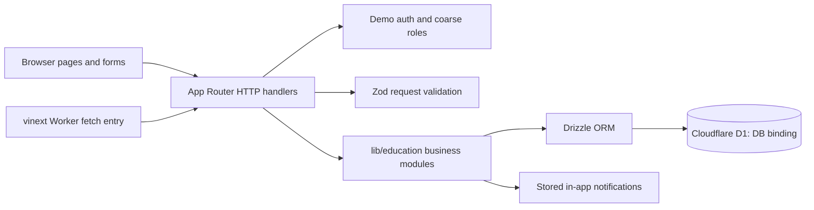

# Rebuild architecture

> Documentation version 1.0 · 5 October 2026 · Draft for sponsor review.
> Describes the Next.js rebuild at `b4cbfc5f6855479ed523b5bf4c0aed0d2b6f6e3d`, not the legacy application on `main`.
> Requirements are proposed targets; code presence does not establish acceptance or production readiness.

## Source-backed architecture

This diagram describes components, not proof that every route enforces authentication or validation. Some server pages access business modules directly; those paths require their own server-side authorization.

## Component responsibilities

| Component | Source | Responsibility / limit |
|---|---|---|
| Pages and layout | app/, components/app-shell.tsx | Browser UI and dashboards; some references have no matching route |
| HTTP routes | app/api/ | Request handling; auth, errors and contracts are inconsistent |
| Domain modules | lib/education/ | Validation and D1 reads/writes, with no complete object-scope layer |
| Identity | lib/education/auth.ts | Fixed demo principals selected by a cookie |
| Role helpers | lib/education/roles.ts | Boolean role permissions; no school/class relationship checks |
| Schema | db/schema.ts, drizzle/ | Tables and constraints |
| Database adapter | db/index.ts | Drizzle client over env.DB; fails if binding absent |
| Worker entry | worker/index.ts | Delegates fetch to vinext; no scheduled export |
| Build/runtime | vite.config.ts, build/sites-vite-plugin.ts | vinext, Vite, Cloudflare and Sites integration |

## Write request lifecycle

Intended lifecycle is verified session → object authorization → body/reference validation → persistence → response/notice. Current implementation follows only parts of this chain. Proposed repair places authorization before all access, uses transactional or explicitly recoverable batch operations, and makes report publication plus notification scheduling safe on retry.

## Decisions represented in code

App Router/React UI with TypeScript; Cloudflare Worker runtime via vinext; Drizzle with D1; Tailwind/shadcn-style components; pnpm for package management. These describe selected implementation choices, not comparative architecture evaluations.

## Proposed architecture changes

Add trusted identity and a single scoped domain authorization layer. Bind student/guardian identities to records explicitly; the students table currently has no userId. Introduce attributable record revisions and an outbox/idempotency design if asynchronous delivery is approved. Agree migration and recovery strategy before schema changes. Capture each adopted choice in a dated decision record with alternatives, owner and consequences.

## External systems

No real identity or email/SMS integration is established by the reviewed application modules. Environment placeholders and copied staging/recovery scripts do not prove integrations are configured. There is no confirmed production topology or running service URL in this assessment.

## Branch separation

Legacy main uses Express/Mongoose and has a separate docs/architecture.md. Do not apply this rebuild diagram or D1 runbook to it. Migration from legacy storage is a future project requiring field mapping, reconciliation and rollback planning.
