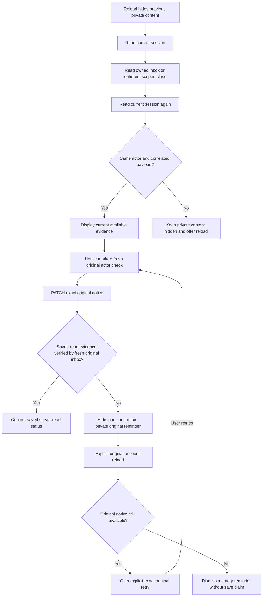

# Current family inbox class views and recovery

Version 2.11 draft, 6 October 2026. Candidate parent `8088b5f88213401ff900506362c227a55120f3c1` is the recorded second-batch revision; the containing publication and main merge remain separately recorded. This design covers current recipient-owned notices and scoped class/student-profile views, preserving the existing APIs, channels and historical records. Read [BRD](BRD.md) → [FSD](FSD.md) → [HLD](HLD.md) → [LLD](LLD.md). Trace: FR-02, FR-03, FR-07–FR-09, FR-12, FR-26; NFR-01–NFR-03, NFR-05–NFR-09. SC-43–SC-44 add TC-294–TC-313. Every approval is false and every designed case remains `not-run-for-this-specification`.

## Current scope and unchanged interfaces

[Personal inbox](../../app/notifications/page.tsx) and [class details](../../app/classes/[id]/page.tsx) clear previous private content before reloading and verify the same actor ID, role and school around their scoped data. Only the current mounted generation can apply a response. These are client request-boundary checks; the server's original-session/account/object SQL scope remains authoritative. They do not continuously monitor another tab or retract content already delivered.

No route, handler, table or field is added: the inventory remains 41 tables/338 fields through migration 0016 and 60 route files/96 handlers. [Notice API](../../app/api/notifications/route.ts), [class API](../../app/api/classes/[id]/route.ts) and their existing services retain current owner/school/class/family scope. Historical notice ownership never grants current report/learner access. Stored `email` or `sms` channel labels remain compatible records; no external delivery is enabled.

## Inbox reads and saved status

Reload immediately hides prior principal, notice articles and marker controls, then performs current session → recipient-owned inbox → current session. The account keys must match and every notice must have a nonempty ID and the same userId. A verified empty inbox is explicit. A failed, malformed, mixed-owner or obsolete response is unavailable data, not a successful empty state. Abort/generation/mounted checks prevent late replies from restoring the former recipient's body or navigation.

Mark as Read requires a current owned unread notice, ready scope and synchronous action lock. Fresh session preflight must match the original account key. The request uses the exact notice ID encoded with URLSearchParams in `PATCH /api/notifications?id=...`; it carries no recipient override or new message. The API returns `{success:true}` without a timestamp. The client therefore reloads a fresh same-actor inbox and requires the original owned notice's valid saved readAt before claiming confirmation. It never assigns a local current time to readAt.

The service preserves first readAt using `coalesce`, and preserves updatedAt after an already-read retry. Displayed creation/read dates come from storage. Only null or missing readAt is unread; every non-null saved value, including an empty string, is disclosed through the stored-date renderer. Only exact canonical UTC timestamps (`YYYY-MM-DDTHH:mm:ss.SSSZ`) with a real calendar day and an unchanged ISO round trip render as times. The shared stored-timestamp helper reuses exact calendar-day validation. Impossible February days, normalized hour 24, ambiguous numeric/date-only literals, offsets, missing milliseconds, whitespace and other noncanonical legacy values show a review warning with the exact original literal. No new mark or repair is offered for invalid non-null read evidence; an acknowledged marker cannot be confirmed from a malformed saved readAt. Viewing or presenting a warning changes no record or retention rule. A late acknowledgement after unmount starts no private refresh or client state update; any already committed server evidence remains saved.

## Uncertain notice recovery

A sent denial, unexpected acknowledgement, lost reply or failed saved-state read hides the old inbox and retains only the original actorKey, notice ID and exact endpoint in page memory. No automatic retry or second marker occurs. An unsent preflight failure or known400 rejection requires a fresh inbox before another action.

Fresh original-account reload exposes an explicit original-notice retry only while that notice is still owned and available. Another account may load its own inbox but cannot inspect, retry or dismiss the first account's pending reminder. Explicit retry rechecks the current account, sends the exact original endpoint and confirms its saved readAt through a separate fresh inbox. It preserves the first saved read time whether the original request had committed or the retry becomes the first successful marker.

If the original notice is unavailable after a verified original-scope reload, its reminder can be dismissed without any mutation. The screen explicitly says no read status was changed or confirmed. Dismissal never recreates a notice or infers that the lost request did not commit. Pending state is memory only; hard reload/navigation/tab loss discards the reminder. Durable recovery, historical notice policy and representative family acceptance remain separate decisions.

## One scoped class snapshot

The existing class GET returns class metadata and enrolledStudents from one SQL statement that intersects class access with each student's scope. The client consumes that payload directly, avoiding separate enrolment/student requests that could mix accounts or produce a misleading partial class. It verifies current session → exact class GET → current session, class ID/school and the embedded profile array/school before displaying any part.

A params Promise change hides a snapshot loaded for the prior route immediately. Old generation, aborted and unmounted requests cannot apply metadata/profile/navigation. Denied or unconfirmed reads clear the whole private snapshot and offer reload/current-class-list/sign-in recovery. A successful empty snapshot says no student profiles are available for this account; it never states there are no other enrolments. The [shared shell](../../components/app-shell.tsx) receives the page's explicit current `Principal | null`. Null immediately hides account identity and every role menu, with a native Login link; the shell performs no independent session lookup or cached identity fallback. The caller clears protected children and verifies fresh scope. The shell is presentation, not continuous identity monitoring or server authorization. Public demo discovery can change only the fictional-data banner, never restore an account header.

Repeated profile IDs in a legacy snapshot are presented once, with the number of repeated entries disclosed. No saved membership row is merged, deleted, repaired or reclassified. Available profiles are a current-access view, not a total roster, historical entitlement or eligibility policy. Class timestamps render from storage; invalid values stay visible as raw review warnings.

Current administrator/teacher views retain the class-specific reviewed attendance editor link. Family views link to the existing `/attendance` summary and instruct the viewer to choose this named currently permitted class. No unsupported query selector or family recording permission is invented. Guardian assigned-learning access remains unsupported; private answer keys, unpublished reports and staff review histories keep their existing server rules.

## Review and evidence boundaries

The session checks below compare actor ID, role and school before applying private content. Each API independently enforces current server authority; the client sequence does not make several HTTP reads one database transaction.

[Family callback contracts](../../tests/integration/family-ui-contract.mjs) substitute React hooks/elements while executing actual synthetic opaque sessions/routes/production Drizzle D1 over SQLite. They hold replies, change real account/link/notice scope, inspect request identity and saved timestamps, and preserve original rows. They do not establish mounted React, keyboard/focus/screen-reader, representative language/scale, hosted recovery or educator acceptance.

The frozen [mounted family procedure](../../tests/worker-family-ui-check.mjs) is related to intentional TC-305/TC-313 review. It defines 36 local browser procedures requiring a matching built localhost Worker, private fictional opaque fixture sessions and a local browser; it has no reading-practice procedure prerequisite. It creates only five suffix-owned in_app notices through the existing authorized handler and marks only three guardian-owned suffix notices. Real saved marker times and exact original lost-reply retry are checked through existing endpoints; named legacy/malformed/cross-school/repeated/empty class projections start with captured actual GETs and separately verify unchanged stored snapshots, rather than fabricate saved records. Actual role switches, ordinary denied/signed-out and empty current inbox controls remain distinct from projections. Class checks mount the actual shell; the inbox has no shared shell. Full-page route changes may cancel old GETs after unmount and do not prove same-document client transitions. Sampled focus/labels and 390px layout are bounded browser procedures, not assistive certification, hosted recovery or named acceptance. All procedures are designed/unrun in this specification; root-maintained dated execution records are separate. Intentional TC-305/TC-313 reviews require a matching built synthetic app and named family/educator/operator reviewers. [Wireframes](WIREFRAMES.md) map source controls separately from the unchanged fictional prototype. [Security plan](SECURITY-NONFUNCTIONAL-TESTS.md), [regression plan](REGRESSION-PLAN.md) and [UAT](UAT.md) retain provider, historical access, retention and assistive/operational decisions. Actual dates/revisions/outcomes are coordinator-maintained execution evidence, not the statuses in this design.
