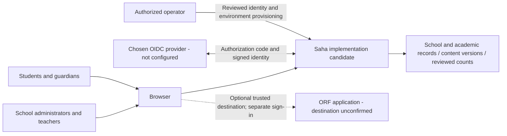
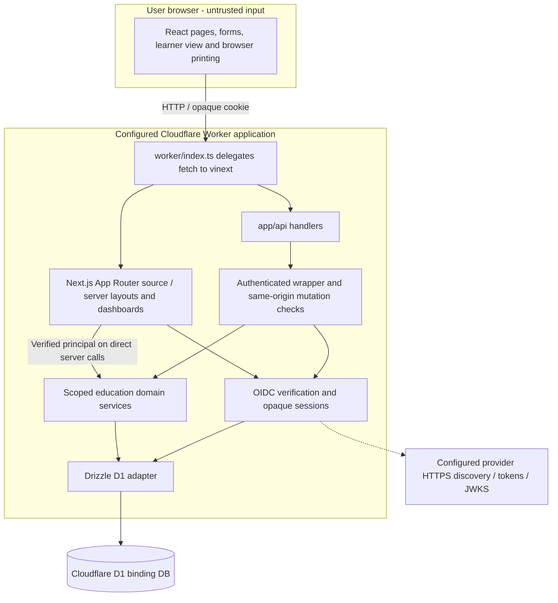
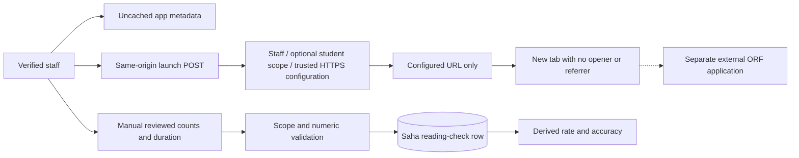

# Saha high-level design

Version 2.0 draft, 5 October 2026. Design baseline: source commit `5488bc0d20412a3d4be0c031c99c259c56834d5e`. Read [BRD](BRD.md), [FSD](FSD.md), then this document and [LLD](LLD.md). Canonical requirement IDs and implementation statuses are in [requirements.json](requirements.json). This describes an implementation candidate and separately identified proposals. Source configuration, successful local builds and synthetic tests do not establish a verified production deployment, provider connection or business acceptance.

## 1. System context and responsibility

Trace: BR-01–BR-12; FR-01–FR-26; NFR-01–NFR-09.

Saha owns school identity mappings, record scope, academic records, resource versions and manual reading observations. The browser presents journeys and supplies candidate inputs; server services decide authority and persist records. A configured OIDC provider supplies signed identity, not school roles. A separate ORF application remains responsible for its own sign-in and operation. AmplifiU is a product reference for original Saha workflows; there is no licensed AmplifiU component or API in this architecture.

The ORF connection is a staff-only launch boundary. No Saha session token, cookie, student identifier, name, transcript or recording is added to its URL. Saha does not call an ORF API or receive synchronized results. Reviewed numeric entry is a separate manual Saha workflow.

## 2. Containers and execution boundary

Trace: FR-01–FR-03, FR-05–FR-20; NFR-01, NFR-02, NFR-04, NFR-07, NFR-08.

The repository contains Next.js App Router source built through Vite/vinext and the Cloudflare plugin. It is one application boundary, not separately deployed frontend, API and identity microservices. `worker/index.ts` exports a fetch handler; stale comments about scheduled handlers do not establish a scheduler. No queue, cron workload, AI service, object-storage workflow or classroom adapter is implemented.

`db/index.ts` obtains the `DB` binding from `cloudflare:workers` and creates the Drizzle adapter. Database access belongs to server modules. Client pages call APIs; server dashboards pass a verified principal into the same scoped services. Browser UI visibility does not substitute for service authorization.

The preserved `.openai/hosting.json` declares `DB`, no R2 bucket and a local project identifier. `vite.config.ts` retains Sites build integration and a placeholder D1 deployment identifier. These are source/build settings requiring environment verification; they are not an infrastructure inventory or authorization to deploy. The application session is separate from any hosting/preview authentication.

## 3. Public, authentication and private boundaries

Trace: FR-01–FR-04; NFR-01, NFR-03.

| Surface | Current boundary | Material limit |
|---|---|---|
| Sign-in screen | Public presentation; starting sign-in is same-origin POST | Chosen provider and tenant are pending; missing settings return unavailable |
| OIDC callback | Public GET entry with browser-bound, expiring, one-use state; verifies token before session | Actual provider compatibility and registration require live synthetic validation |
| Session API | GET reveals only the current verified principal; DELETE revokes the opaque session | Legacy role-selection POST is rejected; no public account provisioning |
| Protected page layouts | Load a server principal and redirect when absent | Layout protection alone does not protect API or server-service calls |
| Education APIs | Authenticate every read; validate Origin on mutations; uncached safe responses | New resource/reading schemas are strict; legacy validators are less complete |
| Domain services | Mandatory principal, role checks and SQL record filters | School/class/profile history policy is incomplete |
| Operator provisioning | Reviewed external environment/account process | No production provisioning UI or automatic first-admin flow |

Provider issuer/subject pairs identify accounts. Current role, school, disabled state and profile relationships reside in Saha records. Provider email, a browser-selected role and public identity headers confer no authority. Opaque session tokens are sent only as secure cookies; D1 stores their digests. Provider client secrets are server configuration, distinct from application sessions and content. No AI or ORF API credentials have been introduced.

## 4. Record scope and data ownership

Trace: FR-03–FR-12, FR-16, FR-17, FR-20; NFR-01, NFR-03.

| Principal | Record authority | Explicit restrictions |
|---|---|---|
| Administrator | Own school records and school resources | No cross-school override; school bootstrap is operator provisioning |
| Teacher | Assigned classes, currently active related students and own resource drafts | Resource ownership and class authority are independent: own draft does not permit assigning to another teacher's class |
| Guardian | Explicitly linked children, own notices, published reports | No resource workspace/assignments, reading-check authoring or assessment-result visibility |
| Student | Explicit student-user link, own notices/published reports and active-class approved resource assignments | No draft APIs; learner assignment JSON excludes teacher notes and answer keys |

Student profiles are linked through `students.userId`; guardian profiles through `guardians.userId` and `student_guardians`. A profile ID is not a login ID. Null legacy links and missing school mappings fail closed. Course/catalog access is school-scoped; class and student-specific records add relationship predicates.

A guardian's access to one child or a student's access to one class never grants access to the full class roster. Enrolment and attendance reads intersect class scope and student scope. Assessment results are staff-only pending publication policy. Report cards add a publication predicate for families. Notices belong to the recipient user, and marking read checks that ownership in the write.

Current scope uses active enrolment and current teacher assignment. Withdrawal, completion or teacher reassignment can remove access to historical class-specific records. Student resource assignments disappear when enrolment is inactive. The design preserves rows but has no temporal entitlement model; retaining records does not establish an agreed historical-access policy.

See [DATA-DICTIONARY](DATA-DICTIONARY.md) for storage relationships and [API-CONTRACTS](API-CONTRACTS.md) for externally observable responses.

## 5. Core academic flows

Trace: BR-01; FR-05–FR-12; NFR-02.

School administrators manage permitted school metadata, students/guardians, course/class setup and enrolment. Teacher IDs and identity-profile links must refer to enabled, matching-role users in the same school. Attendance and assessment batches validate every entry before a transactional D1 batch. Report creation forces a private draft; administrator publication and mapped guardian notices commit together, using deterministic notice IDs for repeat safety.

Core workflow limits remain explicit: legacy academic date rules are weak, correction history is incomplete, enrolment/result pair uniqueness is not fully established, and family assessment publication is deferred. Read/write scope is implemented, but complete administration, academic acceptance and correction policy are not established by that fact.

## 6. Teacher-resource lifecycle

Trace: BR-03–BR-05; FR-13–FR-18; NFR-01, NFR-02.

A stable resource identifies the original author and school. Content is saved in numbered versions. An explicit review marks one exact saved version approved; a new version starts unapproved. Assignment references the approved version rather than a mutable latest resource. The class-assignment insert rechecks current class and resource authority in the database statement. The learner read joins the pinned version and strips staff fields on the server.

```mermaid
stateDiagram-v2
  [*] --> DraftV1: Atomic resource and first content version
  DraftV1 --> ApprovedV1: Explicit exact-version approval
  ApprovedV1 --> AssignedV1: Authorized class assignment
  DraftV1 --> DraftV2: Append revision with expected latest version
  ApprovedV1 --> DraftV2: Append revision; prior approval retained
  AssignedV1 --> DraftV2: New draft does not replace assigned content
  DraftV2 --> ApprovedV2: New explicit approval
  ApprovedV2 --> AssignedV2: New assignment pins version two
```

These labels describe related records, not a single persisted resource status enum. Existing assignments to version one remain valid while version two is a draft. Self-review by an author is currently permitted; independent-review policy is pending. There is no delete/unapprove/rollback endpoint, student submission, online quiz grading or assignment notification. Resource text is rendered as plain text.

Printing reads an exact approved saved version through staff-scoped APIs. The default student edition excludes private fields from the printed article; a teacher explicitly selects the teacher edition. This staff print workflow is distinct from learner API serialization, where private fields are never returned. Browser printing is implemented; downloadable Word/PDF generation is proposed.

## 7. External reading boundary

Trace: BR-06, BR-07; FR-19–FR-21; NFR-03, NFR-06.

The `oral-reading-fluency` registry slot is disabled until a valid `SAHA_ORF_APP_URL` is supplied. Its destination is never chosen by request input. A launch may check an optional student context, but does not transmit that context. Manual reading records contain counts, duration, language, passage reference and fixed manual provenance; they contain no audio or transcript. Rate and accuracy are derived observations, not diagnostic classifications, grade norms or demonstrated comprehension. Comparable-task trends and attributable correction flows remain FR-21 proposals.

## 8. Full-scope extension map

Trace: BR-01–BR-12. This table accounts for all 35 canonical requirements without inventing implemented components.

| Requirement IDs | Current design boundary | Proposed extension / dependency |
|---|---|---|
| FR-01, FR-02, FR-03 | Provider-neutral OIDC, live sessions and scoped services | Chosen provider registration and verified synthetic callback journey |
| FR-04 | Reviewed provisioning outside public app | Account administration, disablement/relinking UI and approval process |
| FR-05, FR-06, FR-07, FR-08 | School/roster/course/class/enrolment services | Complete administration journeys and historical relationship policy |
| FR-09, FR-10, FR-11, FR-12 | Authorized academic writes, private result boundary, published reports and owned in-app notices | Academic date/grading/correction decisions; family result publication; external delivery contracts |
| FR-13, FR-14, FR-15, FR-16, FR-17, FR-18 | Manual drafts, immutable revisions, review, assignment, learner view and printing | Pilot reviewer policy and educator/print acceptance; document-file exports |
| FR-19, FR-20, FR-21 | Disabled trusted launch and manual numeric records | Confirm ORF destination; comparable reading tasks and corrections |
| FR-22, FR-23 | User-entered curriculum context only; no curriculum library or AI service | Licensed/original versioned references, provider choice, human draft review, provenance and budgets |
| FR-24, FR-25, FR-26 | No submission/feedback model, result import/class adapter or general correction audit | Separately designed contracts, mappings, retention and attributable evidence |
| NFR-01, NFR-02, NFR-03 | Identity/scope, protected writes, selected atomic/repeat-safe operations and limited data forwarding | Broader security review, legacy race/correction work and approved privacy/retention policy |
| NFR-04, NFR-05, NFR-06 | Existing browser UI and language tags; no agreed scale/accessibility/language suitability target | Representative workload, accessible role journeys and educator language review |
| NFR-07, NFR-08, NFR-09 | Source/evidence files and synthetic checks | Authorized recovery, support/correlation design and maintained requirement/case/evidence traceability |

Future AI belongs behind a server boundary with structured draft output, validated references, cost limits and human review. It must never automatically approve or assign material. A curriculum library would preserve reference versions and permissions. External adapters would require explicit source identity, replay keys, verified mappings and permission-aware import/export. Submissions/feedback would reference an assignment/version rather than rewrite its content. These are architectural constraints for future design, not callable interfaces or stored models in this baseline; detailed proposals are separated in [LLD](LLD.md).

## 9. Nonfunctional decisions and release implications

Trace: NFR-01–NFR-09; BR-10–BR-12.

Security isolation and learner-field omission are release-blocking behaviors. The remaining nonfunctional targets need owners and evidence: school/user volumes, concurrency, representative journeys, latency, availability, retention, accessibility target and language/browser matrix, RPO/RTO, backup method, restore ownership and incident handling. No numerical SLA, legal certification or recovery capability is inferred from the framework or hosting configuration.

`listResources` currently obtains the latest version for each resource using per-resource queries; lists are not generally paginated. Actual workload must guide later query/index/pagination work. No queue is proposed as a deployed solution to unmeasured load. Recovery must verify foreign keys, identity links, private/published visibility and immutable version/assignment relationships in an authorized isolated environment.

Implementers must preserve migrations and existing records, use synthetic fixtures, and maintain source/design/API/test evidence together. Node SQLite contract tests and a served local Worker check different execution layers; neither alone proves the actual provider or deployed D1 behavior. See [TEST-STRATEGY](TEST-STRATEGY.md), [DECISIONS-RISKS](DECISIONS-RISKS.md) and repository [VALIDATION](../../VALIDATION.md).

## 10. Source anchors

| Architectural concern | Source at baseline |
|---|---|
| Worker and build | `worker/index.ts`, `vite.config.ts`, `.openai/hosting.json` |
| Database binding and schema | `db/index.ts`, `db/schema.ts`, `drizzle/0000_*` through `0003_teacher_resources.sql` |
| Identity and session | `lib/education/identity.ts`, `oidc.ts`, `session.ts`, `auth.ts` |
| HTTP/service boundaries | `lib/education/http.ts`, `access.ts`, `app/api/**`, protected layouts |
| Academic modules | `schools.ts`, `students.ts`, `guardians.ts`, `courses.ts`, `classes.ts`, `enrolments.ts`, `attendance.ts`, `assessments.ts`, `report-cards.ts`, `notifications.ts` under `lib/education/` |
| Resource lifecycle | `lib/education/resources.ts`, `resource-types.ts`, `app/resources/**`, `app/learning/page.tsx` |
| Reading | `lib/education/external-apps.ts`, `reading-checks.ts`, `app/external-apps/page.tsx` |

Source anchors support implementation claims; canonical requirements remain drafts until separately approved and accepted.
