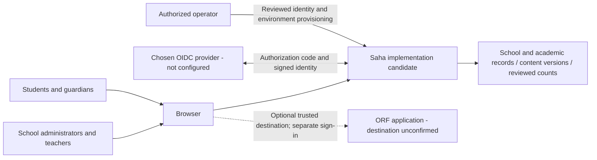
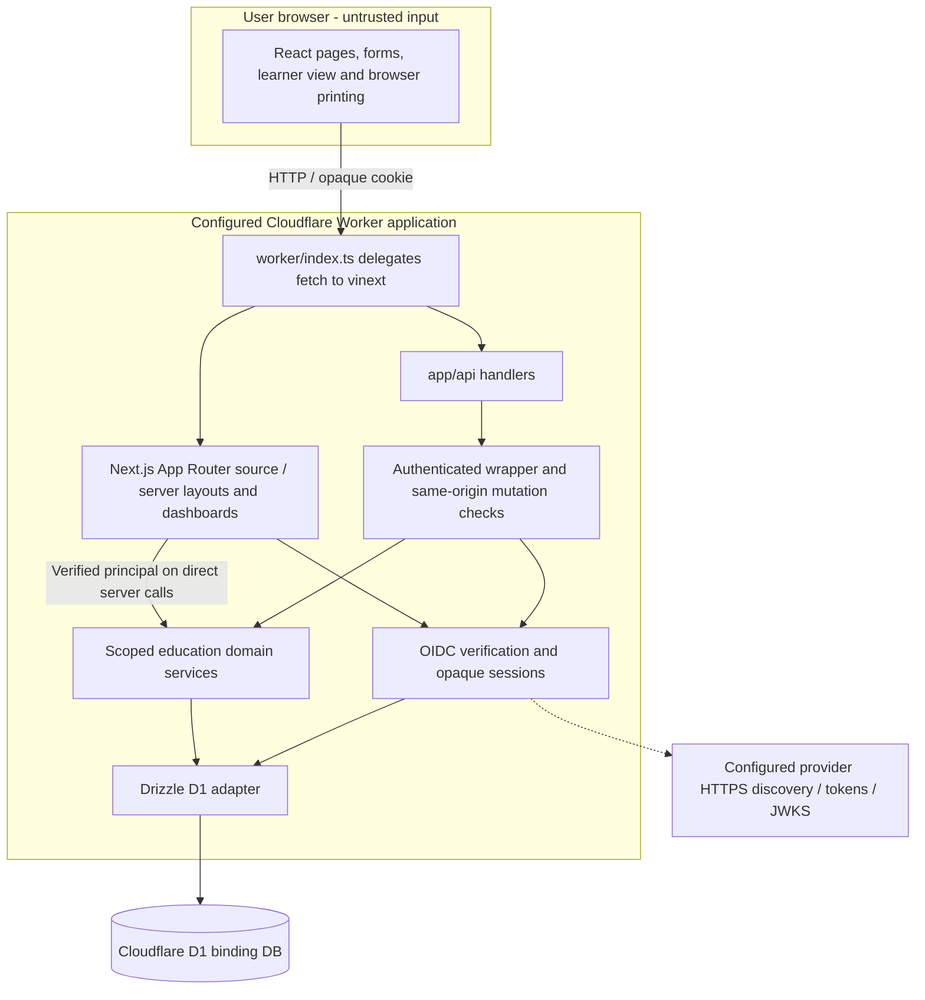
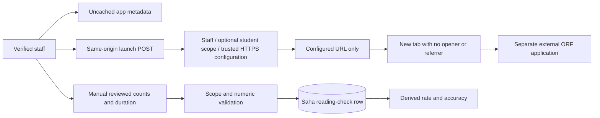
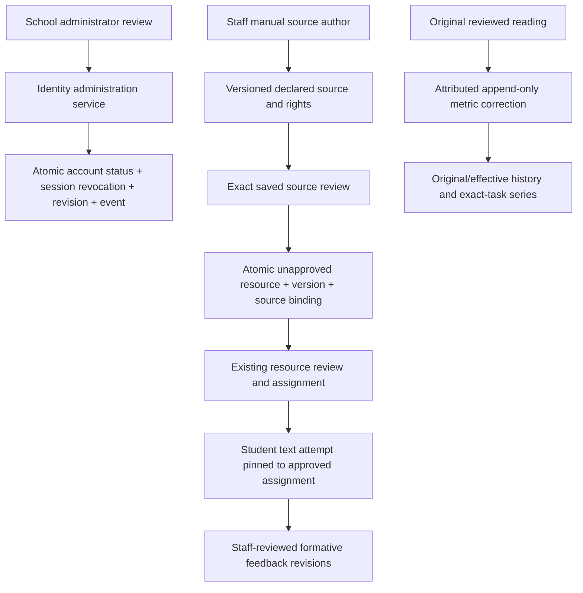
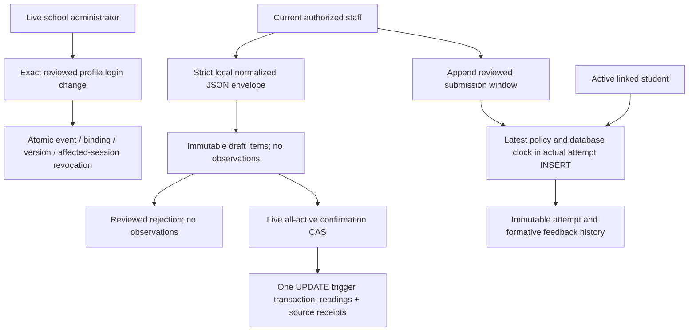
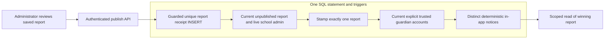

# Saha high-level design

Version 2.6 draft, 5 October 2026. Historical v2.0 baseline: `5488bc0d20412a3d4be0c031c99c259c56834d5e`. Read [BRD](BRD.md), [FSD](FSD.md), then this document and [LLD](LLD.md). Canonical requirement IDs and implementation statuses are in [requirements.json](requirements.json). This describes an implementation candidate and separately identified proposals. Source configuration, successful local builds and synthetic tests do not establish a verified production deployment, provider connection or business acceptance.

The v2.6 implementation candidate was prepared on `feat/specification-delivery`. `source_commit` records `f31288162e1f55ec28ad710ab990ec56ac37ce3c`, the parent of this documented fifth assessment-review batch, rather than the commit containing its changes. Dated publication and execution records are maintained separately. The v2.0 application baseline remains `5488bc0d20412a3d4be0c031c99c259c56834d5e`; v2.1 evidence and published v2.2 at `82f20ce`, v2.3 at `88205cd`, v2.4 at `85e85d0` and v2.5 at `f312881` remain historical. Every requirement is unapproved and every designed case is `not-run-for-this-specification`.

## 1. System context and responsibility

Trace: BR-01–BR-12; FR-01–FR-26; NFR-01–NFR-09.

Saha owns reviewed school identity mappings, record scope, academic records, resource/curriculum versions, text attempts/formative feedback and original/corrected manual reading observations. The browser presents journeys and supplies candidate inputs; server services decide authority and persist records. A configured OIDC provider supplies signed identity, not school roles. A separate ORF application remains responsible for its own sign-in and operation. AmplifiU is a product reference for original Saha workflows; there is no licensed AmplifiU component or API in this architecture.

The ORF connection is a staff-only launch boundary. No Saha session token, cookie, student identifier, name, transcript or recording is added to its URL. Saha does not call an ORF API or receive synchronized results. Reviewed numeric entry and local normalized JSON staging/review are separate manual Saha workflows.

## 2. Containers and execution boundary

Trace: FR-01–FR-03, FR-05–FR-20; NFR-01, NFR-02, NFR-04, NFR-07, NFR-08.

The repository contains Next.js App Router source built through Vite/vinext and the Cloudflare plugin. It is one application boundary, not separately deployed frontend, API and identity microservices. `worker/index.ts` exports a fetch handler; stale comments about scheduled handlers do not establish a scheduler. No queue, cron workload, AI service, object-storage workflow or classroom adapter is implemented.

`db/index.ts` obtains the `DB` binding from `cloudflare:workers` and creates the Drizzle adapter. Database access belongs to server modules. Client pages call APIs; server dashboards pass a verified principal into the dedicated one-statement dashboard read service. Browser UI visibility does not substitute for service authorization.

The preserved `.openai/hosting.json` declares `DB`, no R2 bucket and a local project identifier. `vite.config.ts` retains Sites build integration and a placeholder D1 deployment identifier. These are source/build settings requiring environment verification; they are not an infrastructure inventory or authorization to deploy. The application session is separate from any hosting/preview authentication.

## 3. Public, authentication and private boundaries

Trace: FR-01–FR-04; NFR-01, NFR-03.

| Surface | Current boundary | Material limit |
|---|---|---|
| Sign-in screen | Public presentation; starting sign-in is same-origin POST | Chosen provider and tenant are pending; missing settings return unavailable |
| OIDC callback | Public GET entry with browser-bound, expiring, one-use state; verifies token before session | Actual provider compatibility and registration require live synthetic validation |
| Session API | GET reveals only the current verified principal; DELETE revokes the opaque session | Legacy role-selection POST is rejected; no public account provisioning |
| Protected page layouts | Load a server principal and redirect when absent | Layout protection alone does not protect API or server-service calls |
| Education APIs | Authenticate every read; validate Origin on mutations; uncached safe responses; common JSON parser 128 KiB | New domain schemas are strict; legacy validators are less complete |
| Domain services | Mandatory principal, role checks and SQL record filters | School/class/profile history policy is incomplete |
| Reviewed account administration | Enabled school administrator provisions explicit issuer/subject and reviews status with attributable reason | First-school/admin bootstrap remains operator work; existing account role/identity/school remapping is outside this UI; separate reviewed profile login binding is current |

Provider issuer/subject pairs identify accounts. Current role, school, disabled state and profile relationships reside in Saha records. Provider email, a browser-selected role and public identity headers confer no authority. Opaque session tokens are sent only as secure cookies; D1 stores their digests. Provider client secrets are server configuration, distinct from application sessions and content. No AI or ORF API credentials have been introduced.

## 4. Record scope and data ownership

Trace: FR-03–FR-12, FR-16, FR-17, FR-20; NFR-01, NFR-03.

| Principal | Record authority | Explicit restrictions |
|---|---|---|
| Administrator | Own school records and school resources | No cross-school override; school bootstrap is operator provisioning |
| Teacher | Assigned classes, currently active related students and own resource drafts | Resource ownership and class authority are independent: own draft does not permit assigning to another teacher's class |
| Guardian | Explicitly linked children, own notices, published reports | No resource workspace/assignments, reading-check authoring or assessment-result visibility |
| Student | Explicit student-user link, own notices/published reports and active-class approved resource assignments | No draft APIs; learner assignment JSON excludes teacher notes and answer keys |

Student profiles are linked through `students.userId`; guardian profiles through `guardians.userId` and `student_guardians`. A profile ID is not a login ID. Null legacy links and missing school mappings fail closed. Course/catalog access is school-scoped; class and student-specific records add relationship predicates.

A guardian's access to one child or a student's access to one class never grants access to the full class roster. Enrolment and attendance reads intersect class scope and student scope. Assessment results are staff-only pending publication policy. Report cards add a publication predicate for families. Notices belong to the recipient user, and marking read checks that ownership in the write.

Core learner scope uses active enrolment and current teacher assignment. Withdrawal/completion removes student assignment/submission visibility. The reading review/correction extension retains original-class observations for current assigned staff while the learner remains in the school; staff likewise retain permitted class attempts/feedback. Teacher reassignment or student school transfer removes that current authority. Original new-reading entry still requires active enrolment. These specific preservation choices do not establish a complete temporal entitlement model or an accepted historical-access policy.

See [DATA-DICTIONARY](DATA-DICTIONARY.md) for storage relationships and [API-CONTRACTS](API-CONTRACTS.md) for externally observable responses.

## 5. Core academic flows

Trace: BR-01; FR-05–FR-12; NFR-02.

School administrators manage permitted school metadata, students/guardians, course/class setup and enrolment. Teacher IDs and identity-profile links must refer to enabled, matching-role users in the same school. Attendance uses one guarded JSON INSERT SELECT/upsert; results use an atomic guarded JSON insert/update batch. Both recheck all current eligibility and the live actor in actual statements. Report creation forces a private draft and rechecks current actor/student authority in its INSERT. New publication is one guarded receipt INSERT whose trigger publishes exactly one report and derives eligible guardian notices; deterministic notice IDs preserve repeat safety. Legacy published reports receive no new receipt.

Core workflow limits remain explicit: legacy academic date rules are weak, correction history is incomplete, new enrolment/result duplicate pairs are guarded while unresolved legacy duplicates remain stored, and family assessment publication is deferred. Read/write scope is implemented, but complete administration, academic acceptance and correction policy are not established by that fact.

## 6. Teacher-resource lifecycle

Trace: BR-03–BR-05; FR-13–FR-18; NFR-01, NFR-02.

A stable resource identifies the original author and school. Content is saved in numbered versions. An explicit review marks one exact saved version approved; a new version starts unapproved. Assignment references the approved version rather than a mutable latest resource. The class-assignment insert rechecks current class and resource authority in the database statement. The learner read joins the pinned version and strips staff fields on the server.

```mermaid
stateDiagram-v2
  [*] --> DraftV1: Atomic resource and first content version
  DraftV1 --> ApprovedV1: Explicit exact-version approval
  ApprovedV1 --> AssignedV1: Authorized class assignment
  DraftV1 --> DraftV2: Append revision with expected latest version
  ApprovedV1 --> DraftV2: Append revision; prior approval retained
  AssignedV1 --> DraftV2: New draft does not replace assigned content
  DraftV2 --> ApprovedV2: New explicit approval
  ApprovedV2 --> AssignedV2: New assignment pins version two
```

These labels describe related records, not a single persisted resource status enum. Existing assignments to version one remain valid while version two is a draft. Self-review by an author is currently permitted; independent-review policy is pending. The v2.1 text-attempt/feedback extension references those exact assignments. There is no delete/unapprove/rollback endpoint, online quiz grading or assignment notification. Resource text is rendered as plain text.

Printing reads an exact approved saved version through staff-scoped APIs. The default student edition excludes private fields from the printed article; a teacher explicitly selects the teacher edition. This staff print workflow is distinct from learner API serialization, where private fields are never returned. Browser printing is implemented; downloadable Word/PDF generation is proposed.

## 7. External reading boundary

Trace: BR-06, BR-07; FR-19–FR-21; NFR-03, NFR-06.

The `oral-reading-fluency` registry slot is disabled until a valid `SAHA_ORF_APP_URL` is supplied. Its destination is never chosen by request input. A launch may check an optional student context, but does not transmit that context. Manual reading records contain counts, duration, language, passage reference and fixed manual provenance; they contain no audio or transcript. New correction records append reviewed replacement metrics while preserving the original. History groups exact learner/class/language/task/duration and displays original versus effective latest metrics. Rate/accuracy remain descriptive observations; validated comparability, scoring norms, diagnosis and educator interpretation remain pending.

## 8. Full-scope extension map

Trace: BR-01–BR-12. This table accounts for all 35 canonical requirements without inventing implemented components.

| Requirement IDs | Current design boundary | Proposed extension / dependency |
|---|---|---|
| FR-01, FR-02, FR-03 | Provider-neutral OIDC, live sessions and scoped services | Chosen provider registration and verified synthetic callback journey |
| FR-04 | Reviewed current-school provisioning/status UI, session revocation and administration evidence | Existing account role/identity/school remapping, guardian verification and approved review policy |
| FR-05, FR-06, FR-07, FR-08 | School/roster/course/class/enrolment services | Complete administration journeys and historical relationship policy |
| FR-09, FR-10, FR-11, FR-12 | Authorized academic writes, private result boundary, published reports and owned in-app notices | Academic date/grading/correction decisions; family result publication; external delivery contracts |
| FR-13, FR-14, FR-15, FR-16, FR-17, FR-18 | Manual drafts, immutable revisions, review, assignment, learner view and printing | Pilot reviewer policy and educator/print acceptance; document-file exports |
| FR-19, FR-20, FR-21 | Disabled trusted launch, manual numeric originals, attributable corrections and exact-task history | Confirm ORF destination; educator task/scoring/interpretation and publication policy |
| FR-22, FR-23 | Manual versioned source/rights declarations, exact review and durable unapproved resource copies; no AI service | Pilot curriculum/actual source rights and suitability; provider choice, grounded drafting, budgets |
| FR-24, FR-25, FR-26 | Text/formative evidence, reviewed submission windows and local normalized reading import drafts/receipts; no verified external adapter or general audit system | Grade/late/guardian policy, verified vendor mappings, general academic correction/export/retention |
| NFR-01, NFR-02, NFR-03 | Identity/scope, protected writes, selected atomic/repeat-safe operations and limited data forwarding | Broader security review, legacy race/correction work and approved privacy/retention policy |
| NFR-04, NFR-05, NFR-06 | Existing browser UI and language tags; no agreed scale/accessibility/language suitability target | Representative workload, accessible role journeys and educator language review |
| NFR-07, NFR-08, NFR-09 | Source/evidence files and synthetic checks | Authorized recovery, support/correlation design and maintained requirement/case/evidence traceability |

Future AI belongs behind a server boundary with structured draft output, validated references, cost limits and human review. It must never automatically approve or assign material. The current manual library preserves source-version/declared-rights evidence; verified permissions remain a human pilot dependency. Text submissions reference an assignment/version without rewriting it. External adapters still require explicit source identity, replay keys, verified mappings and permission-aware import/export. The remaining proposed contracts are separated from implemented local-domain interfaces in [LLD](LLD.md).

## 9. Nonfunctional decisions and release implications

Trace: NFR-01–NFR-09; BR-10–BR-12.

Security isolation and learner-field omission are release-blocking behaviors. The remaining nonfunctional targets need owners and evidence: school/user volumes, concurrency, representative journeys, latency, availability, retention, accessibility target and language/browser matrix, RPO/RTO, backup method, restore ownership and incident handling. No numerical SLA, legal certification or recovery capability is inferred from the framework or hosting configuration.

`listResources` now joins each scoped resource to its latest version in one database query, removing the historical per-resource query pattern. All four role dashboards now use one current-actor-anchored SQL read; the administrator uses exact current-school aggregates including enabled mapped teachers, while displayed teacher/family lists expose limits and uncapped totals. Account/event reads are capped 500/200; other lists are not generally paginated and curriculum/feedback reads still contain per-item queries. No capacity/latency claim follows from these changes. Actual workload must guide query/index/pagination work. Recovery must verify foreign keys, reviewed identity events, source-copy bindings, private/published visibility and immutable versions/assignments/attempts/corrections in an authorized isolated environment.

For NFR-09, `scripts/test-catalogue.mjs` reports the canonical 35 requirements and deduplicated runnable evidence links from the designed cases. Catalogue unit checks guard against confusing evidence presence with case execution or business acceptance. Live downstream evidence SELECTs repeat authority checks; `tests/integration/evidence-access-contract.mjs` exercises revocation at those query boundaries.

Implementers must preserve migrations and existing records, use synthetic fixtures, and maintain source/design/API/test evidence together. Node SQLite contract tests and a served local Worker check different execution layers; neither alone proves the actual provider or deployed D1 behavior. See [TEST-STRATEGY](TEST-STRATEGY.md), [DECISIONS-RISKS](DECISIONS-RISKS.md) and repository [VALIDATION](../../VALIDATION.md).

## 10. Source anchors

| Architectural concern | Source baseline plus working extensions |
|---|---|
| Worker and build | `worker/index.ts`, `vite.config.ts`, `.openai/hosting.json` |
| Database binding and schema | `db/index.ts`, `db/schema.ts` and re-exported domain schema modules; migrations 0000–0011 |
| Identity and session | `lib/education/identity.ts`, `oidc.ts`, `session.ts`, `auth.ts` |
| HTTP/service boundaries | `lib/education/http.ts`, `access.ts`, `app/api/**`, protected layouts |
| Academic modules | `schools.ts`, `students.ts`, `guardians.ts`, `courses.ts`, `classes.ts`, `enrolments.ts`, `attendance.ts`, `assessments.ts`, `report-cards.ts`, `notifications.ts` under `lib/education/` |
| Resource lifecycle | `lib/education/resources.ts`, `resource-types.ts`, `app/resources/**`, `app/learning/page.tsx` |
| Reading | `lib/education/external-apps.ts`, `reading-checks.ts`, `reading-review.ts`, `app/external-apps/page.tsx`, `app/reading-review/**` |
| Reviewed accounts | `lib/education/identity-admin.ts`, `db/identity-admin-schema.ts`, `app/admin/users/**` |
| Manual curriculum | `lib/education/curriculum.ts`, `db/curriculum-schema.ts`, `app/curriculum/**` |
| Attempts/formative feedback | `lib/education/submissions.ts`, `db/submission-schema.ts`, `app/api/assignments/**`, learner assignment pages |

## 11. Working manual delivery components

Trace: FR-04, FR-21, FR-22, FR-24, FR-26; NFR-01, NFR-02, NFR-09. Each expanded FR remains partial because its broader policy/integration/retention scope is unresolved.

These services share the existing authenticated Worker/Drizzle/D1 boundary. The historical v2.1 set introduced eight additive tables and thirteen route files, with no new external runtime, message channel or AI provider. Account and curriculum-copy multi-record operations use D1 atomic batches; revisioned attempts/feedback/corrections use guarded INSERT SELECT with unique sequence keys. Current authority is checked inside the mutation, not merely before it. The correction table also has database no-update/no-delete triggers. Other histories are append-only through their current APIs, without a claimed database-wide immutable audit layer.

Source anchors support implementation claims; canonical requirements remain drafts until separately approved and accepted.

## 12. v2.2 control and evidence components

Trace: FR-04, FR-06, FR-08, FR-09, FR-10, FR-20, FR-24, FR-25, FR-26; NFR-01, NFR-02, NFR-03, NFR-05, NFR-09. Six additive tables and seven route files extend the existing boundary to 34 tables/288 fields and 51 route files/84 handlers. Migration 0009 adds guards/indexes rather than tables. No external runtime or credential is added.

Profile-link events retain original and replacement ownership while explicit profile FKs prevent anonymous target types. Current ownership version is separate from account administration version; a past link decision cannot overwrite a later state. The batch excludes reviewing-admin session revocation to support repair of malformed legacy links. Current-school history/read/replay scope remains required after profile transfer. Actual actor checks also protect ordinary profile/student-guardian reads and updates.

Import drafts keep one explicit class and every normalized learner ID. Server-prepared rows are materialized by a stage trigger; unreviewed/rejected items never enter reading_checks. A terminal confirm trigger inserts all reading originals and provenance receipts atomically. Unique school/declared source namespace/result reference receipts reject consumption in a different draft without cross-school metadata disclosure. Pending duplicates may coexist. Confirm requires all active membership at the mutation; reject/history may retain withdrawn same-school items for current authorized staff. Source declarations are untrusted manual input, not vendor authentication.

Submission-window review is independent of due_date and resource content versions. A latest immutable open policy accepts unless its cutoff has elapsed; no policy means unrestricted. The actual learner attempt INSERT uses database time and the latest revision, closing the prevalidation race. Committed UUID replay precedes that new-write check and still requires current learner authority. Feedback remains permitted on authorized saved attempts after closure.

Academic pair guards preserve existing duplicates without a destructive migration or invented review history. Attendance shares one all-member eligibility predicate in a single statement; result insert/update shares current class/max-score/active-member/ambiguity predicates inside an atomic batch. These controls do not add academic-calendar acceptance, general corrections or production-scale guarantees. Node SQLite tests and local workerd checks remain different execution layers; actual root-run evidence is recorded separately.

## v2.3 authority and publication transaction boundary

Trace: BR-01, BR-02, BR-10; FR-03, FR-05–FR-07, FR-11, FR-12, FR-26; NFR-01–NFR-03.

`livePrincipalScope` composes into actual common student/class/guardian SQL predicates and remaining school/course/users/notice statements. It compares current user ID, role and school with the principal and requires enabled nonempty trusted mapping. The current Principal does not carry an issuer/subject snapshot: this guards absent mappings, not arbitrary replacement of one nonempty identity pair with another. Identity remapping remains unavailable through application APIs. Mutation-time references complement early validation; neither browser controls nor an earlier session lookup supplies lasting authority.

Class detail is one scoped class/enrolment/student join, avoiding a cached class response assembled after dependent roster lookups. Class persistence checks course and teacher eligibility in the same INSERT/UPDATE. These changes preserve current entitlement rules, historical records, private account fields and existing response shapes.

An authority conflict or later trigger/notice failure rolls back the whole statement. A publication with no eligible recipients still commits the report. Concurrent losers and retries only read the current permitted winner; they cannot independently assemble notices. Six-field immutable `report_publication_receipts` is private database evidence, not a new API or complete audit/retention system. Historical reports/notices are not recreated or backfilled.

The report UI separates uncertain draft creation from repeat-safe publication. The inbox retains content after acknowledgement failure. Role-appropriate school/course/class forms use verified-school context, while APIs remain authoritative. Local tests/builds do not prove hosted D1 recovery, real provider delivery, educator policy or production readiness.

## v2.4 coherent dashboard read boundary

Trace: FR-03, FR-08–FR-11; NFR-01–NFR-04, NFR-09. The four server pages use one `getRoleDashboard(principal)` call after session resolution. One SELECT is anchored on the current enabled mapped users row and valid current school. Its scalar JSON/CTE read assembles independently aggregated role collections under that same SQL snapshot, avoiding stale earlier profile/class arrays and join multiplication. Lost actor authority returns no outer row/null. Nested actor/class/profile/student/report scope does not rely on earlier service reads.

The read projects minimal displayed fields; it adds no API route, table, migration or provider call. Teacher/family list caps bound response size while exact uncapped counts and truncation stay visible. Counts describe stored observations/current-roster recording, not an educational model. No confirmed evidence is modified, merged or backfilled. Existing family attendance class eligibility and published-only reports remain independent.

`asOf` is database UTC time at the snapshot; it does not retract previously delivered content when a later write changes authority. Principal lacks a session digest, so the current-actor predicate cannot establish session-only revocation after resolution. Bound output and one statement do not prove capacity; representative D1 workloads and approved targets remain pending. See [the exact service design](DASHBOARD-DESIGN.md) and [SC-26–SC-28](TEST-SCENARIOS.md).

## v2.5 attendance statement and transaction boundaries

Trace: FR-03, FR-08, FR-09, FR-26; NFR-01–NFR-04, NFR-07–NFR-09. Migration 0013 adds two tables/15 fields: `attendance_reviews` and `attendance_review_entries`. Current inventory is 37 tables/309 fields and 54 API route files/88 handlers. No external integration, credential or educational policy is introduced.

The reviewed recorder and summary viewer call separate internal services. `getAttendanceEditor` and `getAttendanceSummary` each use one current-scoped class-anchored SELECT for coherent identity/marks or raw evidence. Family summary scope follows the existing class/student intersections; staff editor/review/history remains staff-only. Compact Principals lack a session hash, so statement-time actor/mapping/reference checks do not promise session-only revocation after resolution or retraction of already delivered content.

Reviewed recording uses a single `attendance_reviews` INSERT SELECT guarded by actual live academic authority. BEFORE INSERT validates whole-roster bounds/ambiguity, changed member eligibility and exact full saved-record compare-and-swap. AFTER INSERT atomically upserts changed attendance tuples and derives immutable before/after entries from actual persisted rows. Any trigger/audit fault aborts the complete statement. UUID collision/retry reads current receipt scope and original canonical payload; replay never executes a new mark replacement.

Original-batch receipt/history SELECTs require current class/live staff authority and every original pupil still in the actor school. Withdrawal alone retains evidence; transfer hides the entire batch. Separate legacy attendance writes remain mutable and do not gain automatic review history. Observed summaries include current accessible active pupils or eligible stored records, without individual notes or attendance percentage. Exact totals precede 100-item display caps. [Attendance design](ATTENDANCE-DESIGN.md) defines DTOs, algorithm and residual boundaries; hosted D1/recovery and intentional educator/accessibility acceptance remain separate evidence.

## Fifth-batch coherent result and reviewed commit architecture

Trace: FR-03, FR-08, FR-10, FR-26; NFR-01–NFR-09. Additive 0014 introduces two immutable evidence tables/16 fields, giving 39 tables/325 fields and 56 API route files/91 handlers. The staff detail page uses separate result-editor GET/POST and history GET, preserving original results API behavior and every old tuple. No external runtime, vendor, credential or family publication flow is added.

One guarded assessment SELECT supplies current class/metadata/active distinct roster/full saved result previews and SQL asOf. Actual academicClassWrite anchors live actor/class scope; no independently assembled old roster/current empty result feed. Exact totals remain separate from roster 100, per-pupil record 10 and history 100 display bounds. Raw score/maximum/type projects safely, with opaque/unsafe/nonfinite evidence and whole current pair ambiguity blocking review.

A single receipt INSERT runs BEFORE current-authority/metadata/full-result CAS guards and AFTER existing update/new insert/immutable-event commit. SQLite statement atomicity and exact row-count checks prevent partial batches even after an evidence fault. Canonical digest binds actor/school/assessment/original metadata/reason/sorted entries; exact UUID replay reads original receipt and never replays later marks. Both new tables block UPDATE/DELETE through immutable-row triggers.

Downstream receipt/history reads repeat current original class, assessment reference and every original pupil school. This preserves permitted same-school withdrawal history but hides whole transferred batches without deleting them. Compact Principal retains its session-only revocation/remapped-identity limitations after resolution; no full temporal entitlement model is added. Root-maintained actual built/D1/recovery/browser evidence and [assessment design](ASSESSMENT-DESIGN.md) define practical limits; approval remains false.
