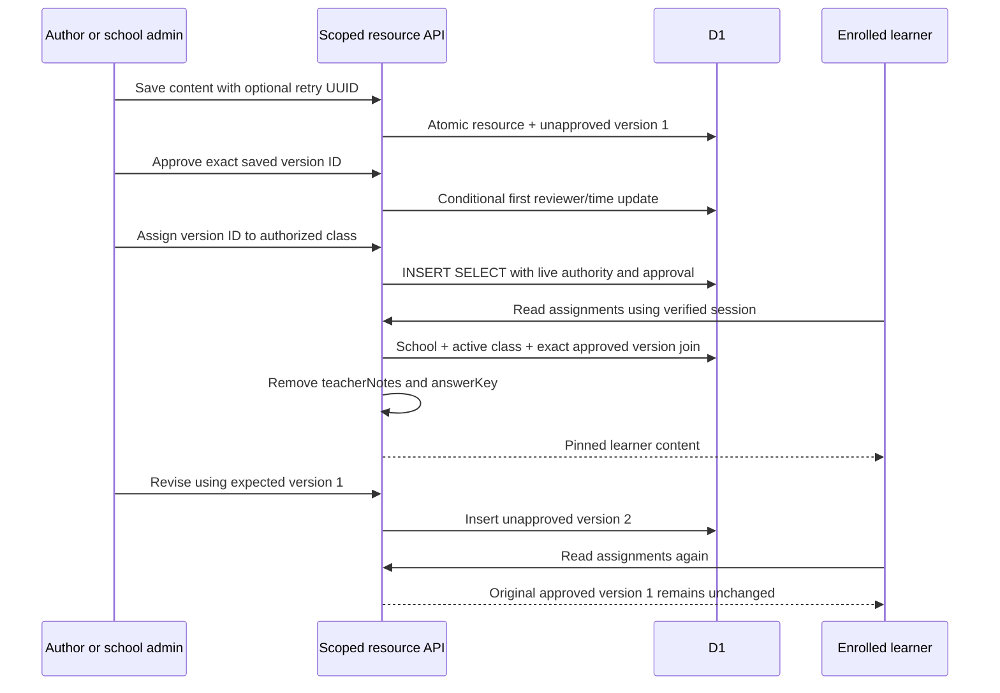

# Saha low-level design

Version 2.0 draft, 5 October 2026. Written after [BRD](BRD.md), [FSD](FSD.md) and [HLD](HLD.md). Source baseline: `5488bc0d20412a3d4be0c031c99c259c56834d5e`. [requirements.json](requirements.json) is the canonical register. Sections 1–9 describe current candidate code; section 10 contains explicitly proposed future designs. No provider, queue, classroom adapter or AI runtime is inferred from a proposed model. This document is an implementer/QA reference, not deployment or acceptance evidence.

## 1. Modules, contracts and execution adapters

Trace: FR-01–FR-20; NFR-01, NFR-02, NFR-09.

| Module / source | Public contract or responsibility |
|---|---|
| `identity.ts` | `AuthError`, trusted server `setting`, `requireSameOrigin`, URL/cookie helpers, random tokens and SHA-256 digest |
| `oidc.ts` | `oidcConfig`, `discover`, `startLogin`, `finishLogin`, `validateIdentityClaims`; provider authorization-code flow |
| `session.ts` | `principalForToken`, `createSession`, `revokeSession`, `revokeUserSessions`; opaque sessions |
| `auth.ts` | Async `getPrincipal(request)`, `getServerPrincipal`, `requirePrincipal`; role assertion |
| `http.ts` | `authenticated(request, mutation, action)`, `body`, `found`, `query`; common API boundary |
| `access.ts` | `AccessError`, principal/admin/school checks, student/class/guardian SQL predicates and reference validation |
| Core academic modules | Principal-first school, roster, class, enrolment, attendance, assessment, report and notice operations |
| `resources.ts` | Resource schemas, creation/revision/version reads/approval/assignment, `ResourceConflict` |
| `resource-types.ts` | Shared `ResourceContent`, `ResourceVersion`, `TeachingResource`, `ResourceAssignment` |
| `external-apps.ts` | Staff registry and launch-only destination validation; no outbound app request |
| `reading-checks.ts` | Strict numeric input, scoped reads, repeat-safe create and derived rate/accuracy |
| `client-api.ts` | Browser fetch helpers; uncached requests and sign-in redirect on 401 |
| `db/index.ts`, `db/schema.ts` | `cloudflare:workers` DB binding, Drizzle D1 adapter and relational definitions |

All record-oriented domain services require a `Principal` as the first argument. `Principal` is `{id, role, schoolId?}` with role `admin | teacher | guardian | student`; access checks require a valid school. Public requests never construct an authoritative principal from headers/body. Client code imports shared types and API helpers, not D1 services. Server dashboards obtain `getServerPrincipal()` and pass it to scoped services.

Production-shaped execution is the vinext fetch application in `worker/index.ts`, built with the Cloudflare Vite plugin. Node contract tests replace the Worker binding with an isolated SQLite adapter; that adapter must return arrays preserving SQL column order, including duplicate column names in joined selections. Converting joined rows through `Object.values` on named objects can corrupt values and invalidate privacy assertions. `tests/support/security-db.mjs` uses `StatementSync.setReturnArrays(true)` and applies actual numbered migrations with foreign keys enabled. A passing Node adapter test is distinct from served Worker/D1 behavior, provider compatibility and deployment evidence.

Exact HTTP routes/status/payload tables are maintained in [API-CONTRACTS](API-CONTRACTS.md); columns, keys, nullability and migration descriptions in [DATA-DICTIONARY](DATA-DICTIONARY.md). Implementers must check both before changing an interface.

## 2. Request, error and visibility rules

Trace: FR-02, FR-03; NFR-01, NFR-03.

For education endpoints, `authenticated` resolves the current principal before parsing content or calling services. Missing authentication returns 401. Mutations then call `requireSameOrigin`: Origin must be present, non-null, equal the request URL origin and included in configured `SAHA_ALLOWED_ORIGINS`; `Sec-Fetch-Site: cross-site` is rejected. Reads do not require Origin. This is a cookie-based application mutation contract, not a supported cross-origin third-party API.

Successful and failing education responses use `Cache-Control: no-store`. `AccessError` carries 400/403/404; `AuthError` carries controlled authentication/configuration status. Malformed JSON and Zod validation errors map to generic 400; unexpected errors map to generic 500. Resource and reading handlers explicitly catch their domain conflicts and return safe 409 bodies. The auth route helper is separate: login can return controlled 429/503; callback failure redirects with 303 to `/login?error=signin_failed`, clears the OIDC cookie and never puts provider details in the URL. No arbitrary exception text should be surfaced by new APIs.

| Condition | Education response meaning |
|---|---|
| 400 | Invalid request/schema or authorized domain precondition failure |
| 401 | No usable live session |
| 403 | Role/operation denied, missing school authority or origin failure |
| 404 | Scoped record/reference unavailable; does not establish whether a foreign record exists |
| 409 | Retry payload/actor collision or optimistic concurrency conflict |
| 500 | Unexpected application/database failure with generic response |
| 503 | Required trusted app/provider configuration unavailable |

New resource/reading request schemas are strict and reject unknown authority-bearing fields. Core `validation.ts` schemas generally strip unknown fields and have optional legacy system fields; update services omit `id`, `createdAt`, `updatedAt` before writing and derive system values. Do not describe the entire legacy schema set as strict, date-normalized or audit-complete.

`found(null)` returns a controlled unavailable-record failure. Query identifiers refine or select permitted data; they never expand a principal's scope. Response-field omission must happen before serialization: hiding a staff field in React is insufficient.

## 3. Identity and session implementation

Trace: FR-01, FR-02, FR-04; NFR-01.

### 3.1 Configuration and provider flow

Server settings are `SAHA_OIDC_ISSUER`, `SAHA_OIDC_CLIENT_ID`, optional `SAHA_OIDC_CLIENT_SECRET`, `SAHA_OIDC_REDIRECT_URL`, optional `SAHA_OIDC_TOKEN_AUTH_METHOD`, and `SAHA_ALLOWED_ORIGINS`. Worker bindings precede local process configuration. Required values missing fail unavailable. The configured issuer and callback must be HTTPS without credentials/fragments; issuer/callback queries are rejected, callback path must be `/api/auth/callback`, and callback origin must be allowed.

Token authentication supports `client_secret_basic`, `client_secret_post`, or `none`. Default is basic when a client secret exists, otherwise none. Non-`none` methods require a secret. Discovery must return the exact configured issuer, HTTPS authorization/token/JWKS endpoints, a supported token-auth method and at least one permitted signing algorithm: `RS256`, `PS256`, `ES256`, `EdDSA`. Discovery and token requests reject HTTP redirects, use ten-second timeouts and bounded JSON response handling (65,536 characters; content-length is also checked). ID token input is bounded to 32,768 characters.

Login initiation rate-limits atomically by ten-minute window and SHA-256 of the Cloudflare-supplied client IP: at most twenty attempts per bucket; absent edge IP uses one restrictive shared bucket. This rule relies on the deployed edge replacing the header. A local untrusted forwarded header is not evidence of production rate-limit integrity.

Start-login generates 32-byte random state, browser binding, PKCE verifier and nonce. D1 stores state/browser hashes plus verifier, nonce and five-minute expiry. Authorization parameters include `response_type=code`, `scope=openid`, configured client/callback, state, nonce and `code_challenge_method=S256` with SHA-256 verifier challenge. The browser-binding cookie is `__Host-saha_oidc`, Secure, HttpOnly, SameSite=Lax, Path=/, five-minute Max-Age.

```mermaid
sequenceDiagram
  participant B as Browser
  participant R as Auth route / OIDC module
  participant D as D1
  participant P as Configured provider
  B->>R: Same-origin POST /api/auth/login
  R->>D: Atomic rate bucket increment
  R->>P: HTTPS discovery
  R->>D: Store hashed state/browser + verifier/nonce/expiry
  R-->>B: Authorization URL + browser-binding cookie
  B->>P: Authorization code request with S256 challenge
  P-->>B: Redirect callback code + state
  B->>R: GET callback with transaction cookie
  R->>D: DELETE matching unexpired transaction RETURNING
  alt Matching transaction consumed once
    R->>P: Code exchange with verifier; retrieve signing keys
    R->>R: Verify signed issuer/audience/claims/nonce
    R->>D: Map exact issuer and subject to enabled user
    R->>D: Revoke old session; insert digest of new token
    R-->>B: 303 to / with secure session cookie
  else Missing/mismatched/expired or replay
    R-->>B: 303 to generic sign-in failure; no new session
  end
```

Callback validates a single correctly shaped state, one browser cookie and no duplicated code, then atomically consumes the transaction through `DELETE ... RETURNING` with matching hashes and expiry. Consumption precedes exchange; provider failure cannot justify blindly reusing that callback. Provider cancellation and missing/overlong code (over 4,096 characters) fail. A retry starts a new login transaction.

`jose.jwtVerify` verifies signature, allowed algorithm, configured issuer/audience and required `iss`, `aud`, `exp`, `iat`, `sub`, `nonce` with thirty-second clock tolerance. Additional claim checks enforce transaction nonce; nonempty subject of at most 255 characters; issued-at not beyond allowed future skew; and `azp` matching the client when required by multiple audiences or supplied explicitly. Exact `(identityIssuer, identitySubject)` then maps to an enabled provisioned user with a school and supported Saha role. Email matching and provider role claims do not provision authority.

**Actual transaction limitation:** `oidc_transactions` stores no issuer/client/redirect fingerprint. Provider binding occurs through configured discovery, verified token issuer/audience/nonce and the provisioned issuer/subject mapping; the transaction does not freeze its original configuration. Keep issuer/client/redirect configuration stable through outstanding five-minute transactions. A configuration-switch policy and/or persisted fingerprint would be a future change requiring schema and callback tests. No such field is claimed here.

### 3.2 Opaque sessions and revocation

A session token is 32 random bytes encoded as 43 base64url characters. Only its SHA-256 digest is persisted with user ID, creation epoch milliseconds and eight-hour expiry. `__Host-saha_session` is Secure, HttpOnly, SameSite=Lax, Path=/ and Max-Age 28,800 seconds. Duplicate or malformed session cookies yield no principal.

Every principal lookup joins the session to the current user and checks expiry, disabled state, school, role and identity issuer/subject presence. Role/school changes therefore take effect on subsequent requests. Provider account state is not continuously polled. `DELETE /api/session` deletes the current token digest and expires cookies. `revokeUserSessions(userId)` is available for future account administration; that UI/process remains FR-04 planned. Expired session/transaction/rate rows are cleaned during relevant operations, not by an implemented scheduler.

## 4. Scope predicates and core academic contracts

Trace: FR-03–FR-12; NFR-01, NFR-02, NFR-03.

### 4.1 SQL authority

`assertPrincipal` requires ID, school and supported role. `assertAdmin` adds administrator role; `assertSchool` rejects a supplied school unequal to the principal school. `studentScope` intersects school with: all school students for an admin; explicit `students.userId` for a student; a matching `guardians.userId`/school through `student_guardians` for a guardian; or active enrolment in a currently assigned teacher class for a teacher.

`classScope` intersects school with admin-all, matching `classes.teacherId` for teacher, or active enrolment whose student satisfies `studentScope` for family/student. `guardianScope` similarly permits school admin, the matching guardian login, or a relationship to a permitted student. `studentReferenceScope`/`classReferenceScope` are correlated EXISTS predicates used on enrolment, attendance, reading and assignment records. Class access never replaces student scope on a class roster.

`assertClassWrite` allows only admin/teacher and confirms class scope. `assertStudentInClass` additionally requires permitted student access and active enrolment in that exact class. `assertUserLink` verifies referenced student/guardian/teacher users are enabled, role-matched and in the same school. Login IDs and profile IDs remain distinct.

### 4.2 Principal-first operations

| Domain | Key operations / preconditions | Candidate limits |
|---|---|---|
| School (FR-05) | `listSchools`, `getSchool`, own-school `updateSchool`; `createSchool` denies school-admin bootstrap | Operator bootstrap process pending |
| Student/guardian (FR-06) | Admin create/update/link; scoped list/get; explicit matching-role identity links; omitted mappings preserved on update | Complete provisioning/relinking UI, consent/retention and history policy pending |
| Course/class (FR-07) | Admin create/update; class course and enabled teacher belong to school; scoped class get/list | Catalog is school-scoped; no curriculum-library verification |
| Enrolment (FR-08) | `enrolStudent`, `updateEnrolmentStatus`; admin same-school student/class references | Status enum `active | withdrawn | completed`; pair-unique/concurrent lifecycle and temporal history remain gaps |
| Attendance (FR-09) | `markAttendance(principal,classId,date,entries,principal.id)` validates full batch then transactional upsert | Status `present | absent | late | excused`; legacy date string/correction policy incomplete |
| Assessment (FR-10) | `createAssessment`, `recordResults`, `listResults`; assigned class; enrolled students; score range and no duplicate batch students | Kind `exam | quiz | assignment | project`; score/maxScore integers ≥0, score ≤max; result-pair uniqueness/corrections incomplete; family result reads denied |
| Report (FR-11) | Admin create private draft; admin publish; family read requires publishedAt and student scope | Supplied overall grade, no accepted grade engine; general correction/revision workflow pending |
| Notice (FR-12) | Recipient-owned list/get/read; admin or related teacher recipient scope | Stored notice records; no email/SMS provider activated |

Attendance uses the unique class/student/date index for transactional upserts. Results inspect the assessment/student pair and prepare updates/inserts before a D1 batch; existing legacy pair uniqueness is not equivalent to a database uniqueness guarantee under concurrent inserts. Academic changes currently overwrite selected values without a general append-only correction log. Implementers must not promote these operations to FR-26 completion.

Report creation always overrides `publishedAt` to null. Publication computes distinct mapped, enabled guardian user recipients in the same school, conditionally stamps an unpublished report and inserts in-app notices in one D1 batch. IDs `report-card-published:<reportId>:<userId>` make notice retries nonduplicating; an already published report returns its established evidence. Guardian profile IDs are never notice recipient IDs. The notification schema accepts `in_app | email | sms` channel labels, but `createNotification` only stores a row; it does not deliver externally. `deliverNotification` invokes the in-app create path and rejects other channels as unconfigured. A stored email/SMS-labeled row is not delivery evidence.

Current active/current-assignment predicates remove some historical access after withdrawal, completion or teacher reassignment. Rows remain stored. No temporal relationship snapshots or agreed historical-access exceptions exist; resolve that policy before real records or correction workflows.

## 5. Resource schemas, storage and lifecycle

Trace: FR-13, FR-14, FR-15, FR-16, FR-17, FR-18; NFR-01, NFR-02.

### 5.1 Input and response shapes

`ResourceContent` is `{title,type,curriculum,gradeLevel,subject,language,objectives,body,teacherNotes,answerKey}`. Type is `lesson | worksheet | quiz | activity`. All fields are required; staff notes/key may be empty. The strict schema rejects extra fields.

| Field | Current validation |
|---|---|
| title | Trimmed nonempty string, at most 160 characters |
| curriculum / gradeLevel / subject | Trimmed nonempty, at most 120 / 40 / 80 characters |
| language | Trimmed nonempty, at most 35; 2–3 lowercase language letters followed by optional 2–8 alphanumeric subtags |
| objectives / body | Trimmed nonempty, at most 4,000 / 20,000 characters |
| teacherNotes / answerKey | String, at most 8,000 characters each |
| clientResourceId | Optional UUID for repeat-safe creation |
| expectedVersion | Integer 1–1,000,000 |
| versionId / classId | Nonempty string of at most 120 characters |
| dueDate | Optional exact valid `YYYY-MM-DD` calendar date; no future-only rule |

These are schema/storage bounds, not approved pedagogy, language coverage, workload or SLA targets. Content renders as escaped plain text, not trusted HTML. User-entered curriculum context is not a licensed reference library or independently verified alignment.

`TeachingResource` returns stable ID/school/original author/creation time and a `latest` version. `ResourceVersion` adds version ID, resource ID, number, creator/time and nullable approver/time. `ResourceAssignment` pins version/class, assigner/time and optional due date; its embedded resource omits notes/key for every role. Exact response shapes live in [API-CONTRACTS](API-CONTRACTS.md).

Migration `0003_teacher_resources.sql` creates stable `teaching_resources`, `resource_versions` and `resource_assignments`. Constraints include unique `(resource_id,version)`, valid type/positive integer version, paired null-or-nonnull approval fields and unique `(version_id,class_id)`. IDs are not client authority. Content is immutable through application operations; approval metadata is a single conditional update. No deletion, unapproval, bulk reassignment or content-overwrite endpoint exists.

### 5.2 Atomic create and original retry

```text
createResource(principal, input):
  require staff; parse strict input; derive school and author from principal
  id := clientResourceId or random UUID
  if resource ID exists: return originalRetry(principal, id, canonical content)
  prepare stable resource row and unapproved version 1
  D1 batch(insert resource, insert version 1)
  if success: return resource with version 1
  if uniqueness collision: run originalRetry after rollback
  otherwise: propagate generic failure through API boundary

originalRetry:
  require matching original author AND school for that stable ID
  retrieve version 1
  require exact equality of every validated content field
  return preserved original resource/version; otherwise conflict 409
```

Batch failure leaves neither a partial stable record nor a detached first version. Concurrent identical same-author/school UUID retries converge on one resource. Another author, including a school admin reusing a teacher's create UUID, cannot claim the original operation; foreign reuse or changed content yields 409 without returning another author's content. Original create retry uses version one even after later revisions, rather than silently returning a new draft as if it were the original write.

### 5.3 Append-only revision and one-time approval

```text
reviseResource(principal, resourceId, {expectedVersion, content}):
  require scoped resource (teacher author or same-school admin)
  validate input and read latest numbered version
  if latest.number != expectedVersion: conflict 409
  prepare immutable version expectedVersion + 1, new ID/time/creator
  approvedBy := null; approvedAt := null
  INSERT ON CONFLICT DO NOTHING RETURNING
  if no row returned: conflict 409
  return resource with the new draft

approveResource(principal, resourceId, versionId):
  require scoped resource and exact version belonging to it
  if already approved: return original evidence
  UPDATE approver/time WHERE exact IDs AND both approval fields are null
  return updated row or reread the winner's established evidence
```

Two edits using the same expected version produce one new version and one 409, enforced by the unique version pair. The API does not automatically merge content or silently retry using the latest version. A lost-success revision response requires rereading/version comparison; it is not an overwrite permission. Approval is explicit exact-version confirmation and currently allows author self-review. Concurrent author/admin confirmation retains the first successful approver/time; subsequent content needs new review.

### 5.4 Live-authority assignment and learner serialization

```text
assignResource(principal, resourceId, {versionId,classId,dueDate?}):
  require scoped resource, allowed class write, exact matching approved version
  derive assigner/time; prepare pinned version/class payload
  INSERT SELECT FROM classes JOIN resource JOIN version
    WHERE current classScope AND current resourceScope
      AND exact version/resource IDs AND approval pair nonnull
    ON CONFLICT DO NOTHING RETURNING
  if inserted: return stripped assignment view
  otherwise: scoped lookup of existing version/class/resource assignment
  require exact payload equality, including assigning actor and dueDate
  if matching: return established assignment; else conflict 409
```

The insert rechecks authority in the statement, so a teacher cannot persist an assignment after losing the class between preliminary validation and insertion. A no-longer-authorized insert or different retry actor/date yields a conflict, not an implicit reassignment. Changing an established due date needs a future explicit operation; sending a changed retry is not an update contract.



`listResourceAssignments` joins the exact version/resource relationship, school, nonnull approval pair and `classReferenceScope`. Students require active class membership; guardians receive 403. Teacher/admin assignment preview is class/school scoped. An optional class filter cannot widen scope. `assignmentView` destructures away both private fields before serialization; this applies to staff assignment preview as well as students. Private fields remain available only through permitted staff resource/history APIs.

Printing is a staff browser workflow reading the requested `versionId` from history and checking that exact saved version is approved. Default output is a student edition; a deliberate checkbox includes notes/key in a labeled teacher edition. It is browser printing, not a server document-generation or download API.

## 6. External launch and manual reading checks

Trace: FR-19, FR-20, FR-21; NFR-01, NFR-03, NFR-06.

### 6.1 Trusted destination boundary

`listExternalApps` exposes one slot, `oral-reading-fluency`, title and metadata `capability: launch-only`, `signIn: separate`, `resultSync: false`, allowed roles admin/teacher and an availability boolean. Registry metadata contains no URL. Family roles see unavailable; launch denies them. `launchExternalApp` accepts only the known ID, optional scoped student context and the trusted `SAHA_ORF_APP_URL` setting. Missing/invalid configuration returns 503, unknown app 404, unavailable student 404.

The exact configured destination must parse as HTTPS without credentials, query, fragment, backslash or whitespace; even bare `?`/`#` delimiters are rejected. POST body is strict `{studentId?}`, with a nonempty identifier at most 200 characters. The URL is returned unchanged; no learner/context/token value is appended. Browser opening uses a separate tab, `noopener noreferrer` and no-referrer policy. No request to the external app occurs in these services. Future SSO/results require a new verified FR-25 contract.

### 6.2 Reviewed numeric record

Strict `readingCheckInputSchema` accepts optional UUID `clientCheckId`, class/student IDs, language, passage reference, reading date, duration seconds and attempted/correct word counts. It rejects recorder, school, provenance, calculated metrics, transcript, audio and unknown properties.

| Input | Rule |
|---|---|
| classId / studentId | Trimmed nonempty, maximum 120 characters |
| language | Trimmed length 2–35 with the language/subtag pattern |
| passageReference | Trimmed nonempty, maximum 200; no control/DEL characters or angle brackets |
| readingDate | Exact valid calendar `YYYY-MM-DD`, no later than today **UTC** |
| durationSeconds | Finite number from 1 through 3,600 |
| wordsAttempted | Integer from 1 through 500 |
| wordsCorrect | Integer from 0 through 500 and not exceeding attempted |

After staff/class/active-student checks, persisted duration is `Math.round(durationSeconds * 1000)` milliseconds. School/recorder derive from the principal; fixed source is `oral-reading-fluency`, fixed provenance is `manual-reviewed-external`. A primary-key conflict rereads under matching recorder and school/class/student scope and compares the normalized payload. Same normalized payload returns the original row; changed payload/actor or foreign retry ID yields 409. Server creation time is preserved; no correction/update endpoint exists.

Views calculate `durationSeconds = durationMs / 1000`, `wcpm = Math.round(wordsCorrect * 60000 / durationMs)` and `accuracy = Math.round(wordsCorrect * 100 / wordsAttempted)`. Metrics use stored rounded duration, not a second client calculation. Date policy is UTC in this baseline, not an approved school-local academic calendar. Input bounds do not define language/grade norms, comprehension or diagnostic risk. FR-21 must define comparable tasks, interpretation and attributable corrections separately.

## 7. UI retry and failure behavior

Trace: FR-13–FR-20; NFR-02, NFR-05.

The resource workspace stores a create retry UUID for the same pending payload; optimistic version conflicts require reload/review. A revision changes the saved latest version but does not grant new approval. Assignment and approval confirmation must target the selected saved version. Browser print chooses that approved version explicitly.

The reading page uses synchronous in-flight guards in addition to disabled controls, preventing rapid duplicate submission before React updates. It locks class/form changes during save and remounts the form on class change. On confirmed POST success it displays the returned row immediately, clears the retry state and resets the form; a later history-refresh failure is reported as a saved record with a refresh problem. Uncertain POST failure retains the same payload's retry key. The page clears an old destination before another launch attempt and ignores stale roster/initial-load responses.

These are candidate behaviors. Keyboard/focus/error announcement, print layout across target browsers and educator task completion remain acceptance work; source-level behavior does not satisfy NFR-05 by itself.

## 8. Atomicity, concurrency and preservation ledger

Trace: NFR-02, FR-08–FR-16, FR-20, FR-26.

| Operation | Actual preservation mechanism | Limit requiring separate work |
|---|---|---|
| Callback transaction | One matching `DELETE RETURNING`; replay fails | No configuration snapshot; provider journey pending |
| Login rate | Atomic upsert increment per bucket | Relies on trusted deployed edge IP |
| Attendance batch | Validate all entries, then D1 batch; unique class/student/date upsert | No correction audit; date policy incomplete |
| Results batch | Validate all entries then transactional batch | Pair uniqueness and append-only correction history incomplete |
| Report publication | Conditional publication plus deterministic notices in one D1 batch | Broader publication/correction policy pending |
| Resource create | Stable resource + version-one D1 batch; actor/content retry equality | Create retry always refers to original version; no automatic merge |
| Revision | Unique resource/version number arbitrates writers | Reload/review required after conflict or lost response |
| Review | First conditional approval update; reread winner | Self-review allowed; no unapproval endpoint |
| Assignment | Live-authority `INSERT SELECT`, unique version/class and exact retry equality | No due-date-update or withdrawal operation |
| Reading create | UUID/recorder/scoped normalized-payload equality | No attributable correction/version chain |

D1 batch atomicity is used through the Drizzle D1 adapter; isolated SQLite tests emulate its transaction behavior. Do not replace batches with sequential writes or handle uncertain remote outcomes by generating a fresh key. Preserve existing migrations, source/history and confirmed rows. There is no generalized exactly-once delivery system or implemented queue.

## 9. Verification and unresolved implementation boundary

Trace: NFR-01, NFR-02, NFR-03, NFR-04, NFR-05, NFR-06, NFR-07, NFR-08, NFR-09; FR-01–FR-26.

QA should exercise actual sessions and migrations, foreign/peer IDs, active/inactive enrolment, class reassignment during insertion, duplicate provider callback, malformed/duplicate cookies, expired/disabled sessions, strict authority-field rejection, changed retry actor/payload, resource concurrency, approval winner evidence and learner JSON omission. Inspect persisted rows as well as responses. Synthetic tests must not use real student records, contact real recipients or enable providers implicitly.

Sources include `tests/integration/api-auth-guards.mjs`, `api-contract.mjs`, `external-apps-contract.mjs`, `reading-checks-contract.mjs`, `resources-contract.mjs`, `tests/unit/auth-contract.mjs` and `tests/worker-access-check.mjs`. The latter needs an isolated served Worker and fixture environment. Test coverage, execution and acceptance are distinct; consult [TEST-STRATEGY](TEST-STRATEGY.md) and [VALIDATION](../../VALIDATION.md) for real recorded evidence rather than inferring it from this design.

The baseline has no numerical performance/availability target, deployed-provider validation, production recovery evidence, comprehensive audit/correction model, confirmed retention policy, accepted accessibility result or approved pilot-language matrix. `listResources` performs latest-version queries per resource and lists generally lack pagination. Proposed performance changes require representative workload and measurement. NFR-09 requires requirement/design/API/case/evidence links to move together; historical `docs/education` documents remain source context, not a newer implemented boundary.

## 10. Proposed future design contracts — not implemented

Trace: FR-04, FR-21–FR-26; NFR-03–NFR-09. The following names are conceptual model roles, not exported TypeScript types, migration tables, routes or configured services.

| Proposed capability | Minimum design contract before implementation | Decisions / QA prerequisites |
|---|---|---|
| Identity administration (FR-04) | Reviewed school/role/issuer/subject changes; explicit profile links; disablement calls session revocation; append attributable administrative evidence | Operator/approver roles, guardian verification and reversible relinking rules |
| Comparable reading review (FR-21) | Corrections reference the original observation and retain actor/reason/time; task/language/duration comparability precedes trend interpretation | Educator scoring, passage rights, supported languages and family publication |
| Curriculum library (FR-22) | Versioned original/licensed source references, curriculum/grade/language metadata and permission/suitability review | Pilot curriculum, rights, reference identifiers and educator owners |
| AI draft assistance (FR-23) | Provider chosen and authorized; structured provisional `ResourceContent` validated on server; referenced source versions, prompt/model provenance, review, failures, budget and replay controls | Credential setup, student-data exclusion, grounding/evaluation rubric and cost owner; no automatic approval/assignment |
| Submissions/feedback (FR-24) | Student submission references exact assignment/version and authorized enrolment; revisions and reviewed feedback append evidence without changing assigned content | Submission windows, late/retry rules, guardian visibility, grading policy and retention |
| ORF/class adapters (FR-25) | Verified external identity/record mapping, scoped importer/exporter, source provenance and repeat key; uncertain response reconciliation before retry | Actual provider/API/schema/rights, synthetic sandbox, transport/auth and error contracts; no shared Saha session assumption |
| General audit/corrections (FR-26) | Append actor/time/reason and prior/new reference; agreed access to history; preserve confirmed source records | Administrative versus academic corrections, retention/deletion conflicts and audit-reader role |
| Retention/privacy (NFR-03) | Data inventory, approved retention/deletion/export rules and access review before real data | Named controller/operator and applicable policy review; no certification claim |
| Scale/accessibility/language (NFR-04–06) | Measured representative workload; agreed pagination/index changes; keyboard/focus/error/print checks; educator-reviewed language tasks | User/concurrency/latency/availability and target browser/accessibility/language matrix remain open |
| Recovery/support/change (NFR-07–09) | Authorized backup/restore verification; privacy-preserving error correlation; maintained requirement/design/case/evidence impact links | RPO/RTO, restore/incident owners and release decision process |

Future model/API/schema decisions must update the FSD, these designs, [API-CONTRACTS](API-CONTRACTS.md), [DATA-DICTIONARY](DATA-DICTIONARY.md), risks and tests before claiming runtime availability. Existing generic curriculum labels, a saved manual resource or a launch link do not establish an AI system, licensed library, result adapter or learner classroom service.
