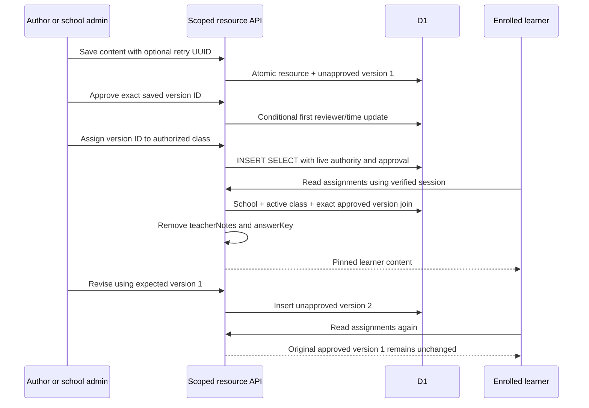

# Saha low-level design

Version 2.3 draft, 5 October 2026. Written after [BRD](BRD.md), [FSD](FSD.md) and [HLD](HLD.md). Historical source baseline: `5488bc0d20412a3d4be0c031c99c259c56834d5e`. [requirements.json](requirements.json) is canonical. Sections 1–9 retain the foundation with relevant current corrections; section 10 defines the historical v2.1 manual extensions; section 11 specifies v2.2 local controls; section 12 defines v2.3 authority/publication controls; section 13 identifies remaining proposals. No provider, queue, classroom adapter or AI runtime is inferred from a proposed model. This is an implementer/QA reference, not deployment or acceptance evidence.

The v2.3 implementation candidate was prepared on `feat/specification-delivery`. `source_commit` records `82f20ce9ae023bdb78d53aecc229331b57bce5eb`, the parent of this documented second batch, rather than the commit containing its changes. The changes were uncommitted when this specification was assembled; dated publication and execution records are maintained separately. The v2.0 application baseline remains `5488bc0d20412a3d4be0c031c99c259c56834d5e`; v2.1 evidence and the published v2.2 batch at `82f20ce` remain historical. Every requirement is unapproved and every designed case is `not-run-for-this-specification`.

## 1. Modules, contracts and execution adapters

Trace: FR-01–FR-20; NFR-01, NFR-02, NFR-09.

| Module / source | Public contract or responsibility |
|---|---|
| `identity.ts` | `AuthError`, trusted server `setting`, `requireSameOrigin`, URL/cookie helpers, random tokens and SHA-256 digest |
| `oidc.ts` | `oidcConfig`, `discover`, `startLogin`, `finishLogin`, `validateIdentityClaims`; provider authorization-code flow |
| `session.ts` | `principalForToken`, `createSession`, `revokeSession`, `revokeUserSessions`; opaque sessions |
| `auth.ts` | Async `getPrincipal(request)`, `getServerPrincipal`, `requirePrincipal`; role assertion |
| `http.ts` | `authenticated(request, mutation, action)`, `body`, `found`, `query`; common API boundary |
| `access.ts` | `AccessError`, principal/admin/school checks, student/class/guardian SQL predicates and reference validation |
| Core academic modules | Principal-first school, roster, class, enrolment, attendance, assessment, report and notice operations |
| `resources.ts` | Resource schemas, creation/revision/version reads/approval/assignment, `ResourceConflict` |
| `resource-types.ts` | Shared `ResourceContent`, `ResourceVersion`, `TeachingResource`, `ResourceAssignment` |
| `external-apps.ts` | Staff registry and launch-only destination validation; no outbound app request |
| `reading-checks.ts` | Strict numeric input, scoped reads, repeat-safe create and derived rate/accuracy |
| `identity-admin.ts` | Reviewed explicit provisioning and status changes; account revisions/events, atomic session revocation, conflict-safe retries |
| `curriculum.ts` | Manual source versions, strict declared-rights/source text, exact review and durable unapproved resource copies |
| `submissions.ts` | Scoped immutable text attempts and explicitly reviewed formative feedback; guarded expected numbers |
| `reading-review.ts` | Preserved originals, append-only correction chains and exact-task descriptive history |
| `client-api.ts` | Browser fetch helpers; uncached requests and sign-in redirect on 401 |
| `db/index.ts`, `db/schema.ts` | `cloudflare:workers` DB binding, Drizzle D1 adapter and relational definitions |

All record-oriented domain services require a `Principal` as the first argument. `Principal` is `{id, role, schoolId?}` with role `admin | teacher | guardian | student`; access checks require a valid school. Public requests never construct an authoritative principal from headers/body. Client code imports shared types and API helpers, not D1 services. Server dashboards obtain `getServerPrincipal()` and pass it to scoped services.

Production-shaped execution is the vinext fetch application in `worker/index.ts`, built with the Cloudflare Vite plugin. Node contract tests replace the Worker binding with an isolated SQLite adapter; that adapter must return arrays preserving SQL column order, including duplicate column names in joined selections. Converting joined rows through `Object.values` on named objects can corrupt values and invalidate privacy assertions. `tests/support/security-db.mjs` uses `StatementSync.setReturnArrays(true)` and applies actual numbered migrations with foreign keys enabled. A passing Node adapter test is distinct from served Worker/D1 behavior, provider compatibility and deployment evidence.

Exact HTTP routes/status/payload tables are maintained in [API-CONTRACTS](API-CONTRACTS.md); columns, keys, nullability and migration descriptions in [DATA-DICTIONARY](DATA-DICTIONARY.md). Implementers must check both before changing an interface.

## 2. Request, error and visibility rules

Trace: FR-02, FR-03; NFR-01, NFR-03.

For education endpoints, `authenticated` resolves the current principal before parsing content or calling services. Missing authentication returns 401. Mutations then call `requireSameOrigin`: Origin must be present, non-null, equal the request URL origin and included in configured `SAHA_ALLOWED_ORIGINS`; `Sec-Fetch-Site: cross-site` is rejected. Reads do not require Origin. This is a cookie-based application mutation contract, not a supported cross-origin third-party API.

Successful and failing education responses use `Cache-Control: no-store`. `AccessError` carries controlled 400/403/404/409; `AuthError` carries controlled authentication/configuration status. Malformed JSON and Zod validation errors map to generic 400; unexpected errors map to generic 500. Resource and reading handlers explicitly catch their domain conflicts and return safe 409 bodies. The auth route helper is separate: login can return controlled 429/503; callback failure redirects with 303 to `/login?error=signin_failed`, clears the OIDC cookie and never puts provider details in the URL. No arbitrary exception text should be surfaced by new APIs.

| Condition | Education response meaning |
|---|---|
| 400 | Invalid request/schema or authorized domain precondition failure |
| 401 | No usable live session |
| 403 | Role/operation denied, missing school authority or origin failure |
| 404 | Scoped record/reference unavailable; does not establish whether a foreign record exists |
| 409 | Retry payload/actor collision or optimistic concurrency conflict |
| 500 | Unexpected application/database failure with generic response |
| 503 | Required trusted app/provider configuration unavailable |

New resource/reading request schemas are strict and reject unknown authority-bearing fields. Core `validation.ts` schemas generally strip unknown fields and have optional legacy system fields; update services omit `id`, `createdAt`, `updatedAt` before writing and derive system values. Do not describe the entire legacy schema set as strict, date-normalized or audit-complete.

The current common `body(request,schema)` helper validates a declared decimal Content-Length when present, reads chunks up to 128 KiB, cancels an oversized stream, releases the reader and decodes UTF-8 in fatal mode before JSON/schema parsing. Missing body, invalid length, malformed encoding/JSON and unknown strict-schema fields are 400. New domain handlers map their conflicts to 409 locally; the common wrapper does not infer a 409 from an arbitrary error's status property.

`found(null)` returns a controlled unavailable-record failure. Query identifiers refine or select permitted data; they never expand a principal's scope. Response-field omission must happen before serialization: hiding a staff field in React is insufficient.

## 3. Identity and session implementation

Trace: FR-01, FR-02, FR-04; NFR-01.

### 3.1 Configuration and provider flow

Server settings are `SAHA_OIDC_ISSUER`, `SAHA_OIDC_CLIENT_ID`, optional `SAHA_OIDC_CLIENT_SECRET`, `SAHA_OIDC_REDIRECT_URL`, optional `SAHA_OIDC_TOKEN_AUTH_METHOD`, and `SAHA_ALLOWED_ORIGINS`. Worker bindings precede local process configuration. Required values missing fail unavailable. The configured issuer and callback must be HTTPS without credentials/fragments; issuer/callback queries are rejected, callback path must be `/api/auth/callback`, and callback origin must be allowed.

Token authentication supports `client_secret_basic`, `client_secret_post`, or `none`. Default is basic when a client secret exists, otherwise none. Non-`none` methods require a secret. Discovery must return the exact configured issuer, HTTPS authorization/token/JWKS endpoints, a supported token-auth method and at least one permitted signing algorithm: `RS256`, `PS256`, `ES256`, `EdDSA`. Discovery and token requests reject HTTP redirects, use ten-second timeouts and bounded JSON response handling (65,536 characters; content-length is also checked). ID token input is bounded to 32,768 characters.

Login initiation rate-limits atomically by ten-minute window and SHA-256 of the Cloudflare-supplied client IP: at most twenty attempts per bucket; absent edge IP uses one restrictive shared bucket. This rule relies on the deployed edge replacing the header. A local untrusted forwarded header is not evidence of production rate-limit integrity.

Start-login generates 32-byte random state, browser binding, PKCE verifier and nonce. D1 stores state/browser hashes plus verifier, nonce and five-minute expiry. Authorization parameters include `response_type=code`, `scope=openid`, configured client/callback, state, nonce and `code_challenge_method=S256` with SHA-256 verifier challenge. The browser-binding cookie is `__Host-saha_oidc`, Secure, HttpOnly, SameSite=Lax, Path=/, five-minute Max-Age.

```mermaid
sequenceDiagram
  participant B as Browser
  participant R as Auth route / OIDC module
  participant D as D1
  participant P as Configured provider
  B->>R: Same-origin POST /api/auth/login
  R->>D: Atomic rate bucket increment
  R->>P: HTTPS discovery
  R->>D: Store hashed state/browser + verifier/nonce/expiry
  R-->>B: Authorization URL + browser-binding cookie
  B->>P: Authorization code request with S256 challenge
  P-->>B: Redirect callback code + state
  B->>R: GET callback with transaction cookie
  R->>D: DELETE matching unexpired transaction RETURNING
  alt Matching transaction consumed once
    R->>P: Code exchange with verifier; retrieve signing keys
    R->>R: Verify signed issuer/audience/claims/nonce
    R->>D: Map exact issuer and subject to enabled user
    R->>D: Revoke old session; insert digest of new token
    R-->>B: 303 to / with secure session cookie
  else Missing/mismatched/expired or replay
    R-->>B: 303 to generic sign-in failure; no new session
  end
```

Callback validates a single correctly shaped state, one browser cookie and no duplicated code, then atomically consumes the transaction through `DELETE ... RETURNING` with matching hashes and expiry. Consumption precedes exchange; provider failure cannot justify blindly reusing that callback. Provider cancellation and missing/overlong code (over 4,096 characters) fail. A retry starts a new login transaction.

`jose.jwtVerify` verifies signature, allowed algorithm, configured issuer/audience and required `iss`, `aud`, `exp`, `iat`, `sub`, `nonce` with thirty-second clock tolerance. Additional claim checks enforce transaction nonce; nonempty subject of at most 255 characters; issued-at not beyond allowed future skew; and `azp` matching the client when required by multiple audiences or supplied explicitly. Exact `(identityIssuer, identitySubject)` then maps to an enabled provisioned user with a school and supported Saha role. Email matching and provider role claims do not provision authority.

**Actual transaction limitation:** `oidc_transactions` stores no issuer/client/redirect fingerprint. Provider binding occurs through configured discovery, verified token issuer/audience/nonce and the provisioned issuer/subject mapping; the transaction does not freeze its original configuration. Keep issuer/client/redirect configuration stable through outstanding five-minute transactions. A configuration-switch policy and/or persisted fingerprint would be a future change requiring schema and callback tests. No such field is claimed here.

### 3.2 Opaque sessions and revocation

A session token is 32 random bytes encoded as 43 base64url characters. Only its SHA-256 digest is persisted with user ID, creation epoch milliseconds and eight-hour expiry. `__Host-saha_session` is Secure, HttpOnly, SameSite=Lax, Path=/ and Max-Age 28,800 seconds. Duplicate or malformed session cookies yield no principal.

Every principal lookup joins the session to the current user and checks expiry, disabled state, school, role and identity issuer/subject presence. Role/school changes therefore take effect on subsequent requests. Provider account state is not continuously polled. `DELETE /api/session` deletes the current token digest and expires cookies. `revokeUserSessions(userId)` remains a helper; the new administration service deletes all target sessions inside its own atomic decision/status/version batch. Existing role/school/identity remapping remains outside this screen. Expired session/transaction/rate rows are cleaned opportunistically, not by an implemented scheduler.

## 4. Scope predicates and core academic contracts

Trace: FR-03–FR-12; NFR-01, NFR-02, NFR-03.

### 4.1 SQL authority

`assertPrincipal` requires ID, school and supported role. `assertAdmin` adds administrator role; `assertSchool` rejects a supplied school unequal to the principal school. `studentScope` intersects school with: all school students for an admin; explicit `students.userId` for a student; a matching `guardians.userId`/school through `student_guardians` for a guardian; or active enrolment in a currently assigned teacher class for a teacher.

`classScope` intersects school with admin-all, matching `classes.teacherId` for teacher, or active enrolment whose student satisfies `studentScope` for family/student. `guardianScope` similarly permits school admin, the matching guardian login, or a relationship to a permitted student. `studentReferenceScope`/`classReferenceScope` are correlated EXISTS predicates used on enrolment, attendance, reading and assignment records. Class access never replaces student scope on a class roster.

`assertClassWrite` allows only admin/teacher and confirms class scope. `assertStudentInClass` additionally requires permitted student access and active enrolment in that exact class. `assertUserLink` verifies referenced student/guardian/teacher users are enabled, role-matched and in the same school. Login IDs and profile IDs remain distinct.

### 4.2 Principal-first operations

| Domain | Key operations / preconditions | Candidate limits |
|---|---|---|
| School (FR-05) | `listSchools`, `getSchool`, own-school `updateSchool`; `createSchool` denies school-admin bootstrap | Operator bootstrap process pending |
| Student/guardian (FR-06) | Admin create/update/link; scoped list/get; explicit matching-role identity links; omitted mappings preserved on update | Reviewed profile login links current; verified family relationship, consent/retention and wider history policy pending |
| Course/class (FR-07) | Admin create/update; class course and enabled teacher belong to school; scoped class get/list | Catalog is school-scoped; no curriculum-library verification |
| Enrolment (FR-08) | `enrolStudent`, `updateEnrolmentStatus`; admin same-school student/class references | Status enum `active | withdrawn | completed`; new duplicate pairs guarded by migration 0009; legacy duplicates retained, temporal/correction history pending |
| Attendance (FR-09) | `markAttendance(principal,classId,date,entries,principal.id)` validates full batch then transactional upsert | Status `present | absent | late | excused`; legacy date string/correction policy incomplete |
| Assessment (FR-10) | `createAssessment`, `recordResults`, `listResults`; assigned class; enrolled students; score range and no duplicate batch students | Kind `exam | quiz | assignment | project`; score/maxScore integers ≥0, score ≤max; new result-pair guard current; ambiguous legacy duplicates conflict; correction history incomplete; family result reads denied |
| Report (FR-11) | Admin create private draft; admin publish; family read requires publishedAt and student scope | Supplied overall grade, no accepted grade engine; general correction/revision workflow pending |
| Notice (FR-12) | Recipient-owned list/get/read; admin or related teacher recipient scope | Stored notice records; no email/SMS provider activated |

Attendance uses the unique class/student/date index in one all-member guarded JSON upsert. Results use an atomic JSON insert/update batch whose actual predicates recheck current score maximum, class/member/actor authority and legacy duplicate ambiguity. Migration 0009 guards new/changed pair duplicates while preserving existing rows. Academic changes currently overwrite selected values without a general append-only correction log. Implementers must not promote these operations to FR-26 completion.

Report creation always overrides `publishedAt` to null and uses a current-actor/student-scoped INSERT SELECT. Publication inserts a unique private receipt; its trigger stamps exactly one draft and inserts distinct currently eligible guardian notices atomically in the same SQL statement. IDs `report-card-published:<reportId>:<userId>` make notice retries nonduplicating; an already published report returns its established evidence. Guardian profile IDs are never notice recipient IDs. The notification schema accepts `in_app | email | sms` channel labels, but `createNotification` only stores a row; it does not deliver externally. `deliverNotification` invokes the in-app create path and rejects other channels as unconfigured. A stored email/SMS-labeled row is not delivery evidence.

Current active/current-assignment predicates remove some historical access after withdrawal, completion or teacher reassignment. Rows remain stored. No temporal relationship snapshots or agreed historical-access exceptions exist; resolve that policy before real records or correction workflows.

## 5. Resource schemas, storage and lifecycle

Trace: FR-13, FR-14, FR-15, FR-16, FR-17, FR-18; NFR-01, NFR-02.

### 5.1 Input and response shapes

`ResourceContent` is `{title,type,curriculum,gradeLevel,subject,language,objectives,body,teacherNotes,answerKey}`. Type is `lesson | worksheet | quiz | activity`. All fields are required; staff notes/key may be empty. The strict schema rejects extra fields.

| Field | Current validation |
|---|---|
| title | Trimmed nonempty string, at most 160 characters |
| curriculum / gradeLevel / subject | Trimmed nonempty, at most 120 / 40 / 80 characters |
| language | Trimmed nonempty, at most 35; 2–3 lowercase language letters followed by optional 2–8 alphanumeric subtags |
| objectives / body | Trimmed nonempty, at most 4,000 / 20,000 characters |
| teacherNotes / answerKey | String, at most 8,000 characters each |
| clientResourceId | Optional UUID for repeat-safe creation |
| expectedVersion | Integer 1–1,000,000 |
| versionId / classId | Nonempty string of at most 120 characters |
| dueDate | Optional exact valid `YYYY-MM-DD` calendar date; no future-only rule |

These are schema/storage bounds, not approved pedagogy, language coverage, workload or SLA targets. Content renders as escaped plain text, not trusted HTML. User-entered curriculum context is not a licensed reference library or independently verified alignment.

`TeachingResource` returns stable ID/school/original author/creation time and a `latest` version. `ResourceVersion` adds version ID, resource ID, number, creator/time and nullable approver/time. `ResourceAssignment` pins version/class, assigner/time and optional due date; its embedded resource omits notes/key for every role. Exact response shapes live in [API-CONTRACTS](API-CONTRACTS.md).

Migration `0003_teacher_resources.sql` creates stable `teaching_resources`, `resource_versions` and `resource_assignments`. Constraints include unique `(resource_id,version)`, valid type/positive integer version, paired null-or-nonnull approval fields and unique `(version_id,class_id)`. IDs are not client authority. Content is immutable through application operations; approval metadata is a single conditional update. No deletion, unapproval, bulk reassignment or content-overwrite endpoint exists.

### 5.2 Atomic create and original retry

```text
createResource(principal, input):
  require staff; parse strict input; derive school and author from principal
  id := clientResourceId or random UUID
  if resource ID exists: return originalRetry(principal, id, canonical content)
  prepare stable resource row and unapproved version 1
  D1 batch(guarded INSERT SELECT resource, guarded INSERT SELECT version 1)
  both statements require live actor; version insert also requires current parent scope
  if both returned actual rows: return those rows with version 1
  if either returned no row: run scoped originalRetry; never fabricate success
  if uniqueness collision: run scoped originalRetry after rollback
  otherwise: propagate generic failure through API boundary

originalRetry:
  require matching original author AND school and current live actor for that stable ID
  retrieve version 1 with repeated current parent/actor scope
  require exact equality of every validated content field
  return preserved original resource/version; otherwise conflict 409
```

Batch failure leaves neither a partial stable record nor a detached first version. Concurrent identical same-author/school UUID retries converge on one resource. Another author, including a school admin reusing a teacher's create UUID, cannot claim the original operation; foreign reuse or changed content yields 409 without returning another author's content. Original create retry uses version one even after later revisions, rather than silently returning a new draft as if it were the original write.

### 5.3 Append-only revision and one-time approval

```text
reviseResource(principal, resourceId, {expectedVersion, content}):
  require scoped resource (teacher author or same-school admin)
  validate input and read latest numbered version
  if latest.number != expectedVersion: conflict 409
  prepare immutable version expectedVersion + 1, new ID/time/creator
  approvedBy := null; approvedAt := null
  INSERT SELECT from current authorized parent
    WHERE live actor/parent scope AND current maximum version = expectedVersion
    ON CONFLICT DO NOTHING RETURNING
  if no row returned: conflict 409
  return resource with the new draft

approveResource(principal, resourceId, versionId):
  require scoped resource and exact version belonging to it
  if already approved: return original evidence
  UPDATE approver/time WHERE exact IDs AND both approval fields are null
    AND current live actor/parent scope
  return updated row or scoped reread of the winner's established evidence
```

Two edits using the same expected version produce one new version and one 409, enforced by the unique version pair. The API does not automatically merge content or silently retry using the latest version. A lost-success revision response requires rereading/version comparison; it is not an overwrite permission. Approval is explicit exact-version confirmation and currently allows author self-review. Concurrent author/admin confirmation retains the first successful approver/time; subsequent content needs new review.

### 5.4 Live-authority assignment and learner serialization

```text
assignResource(principal, resourceId, {versionId,classId,dueDate?}):
  require scoped resource, allowed class write, exact matching approved version
  derive assigner/time; prepare pinned version/class payload
  INSERT SELECT FROM classes JOIN resource JOIN version
    WHERE current classScope AND current resourceScope
      AND exact version/resource IDs AND approval pair nonnull
    ON CONFLICT DO NOTHING RETURNING
  if inserted: return stripped assignment view
  otherwise: scoped lookup of existing version/class/resource assignment
  require exact payload equality, including assigning actor and dueDate
  if matching: return established assignment; else conflict 409
```

Resource scope requires the current enabled account in the same role/school with nonempty trusted issuer/subject mapping. Latest/exact/history/original-retry SELECTs repeat parent authority; stale authorship, administrator demotion or disablement cannot disclose a private version. Resource creation/revision/approval statements repeat that authority, and a no-row creation batch returns only an exact scoped original retry. The dedicated `tests/integration/resource-access-contract.mjs` injects these changes at statement boundaries and inspects persisted rows and safe responses.

The assignment insert also rechecks live actor, resource and class authority in the statement, so a teacher cannot persist an assignment after losing the class between preliminary validation and insertion. Assignment replays recheck parent access, class scope and exact version approval; assigned feeds recheck live staff/learner authority while preserving class/enrolment scope and removing private fields. A no-longer-authorized insert or different retry actor/date yields a conflict, not an implicit reassignment. Changing an established due date needs a future explicit operation; sending a changed retry is not an update contract.



`listResourceAssignments` joins the exact version/resource relationship, school, nonnull approval pair and `classReferenceScope`. Students require active class membership; guardians receive 403. Teacher/admin assignment preview is class/school scoped. An optional class filter cannot widen scope. `assignmentView` destructures away both private fields before serialization; this applies to staff assignment preview as well as students. Private fields remain available only through permitted staff resource/history APIs.

Printing is a staff browser workflow reading the requested `versionId` from history and checking that exact saved version is approved. Default output is a student edition; a deliberate checkbox includes notes/key in a labeled teacher edition. It is browser printing, not a server document-generation or download API.

## 6. External launch and manual reading checks

Trace: FR-19, FR-20, FR-21; NFR-01, NFR-03, NFR-06.

### 6.1 Trusted destination boundary

`listExternalApps` exposes one slot, `oral-reading-fluency`, title and metadata `capability: launch-only`, `signIn: separate`, `resultSync: false`, allowed roles admin/teacher and an availability boolean. Registry metadata contains no URL. Family roles see unavailable; launch denies them. `launchExternalApp` accepts only the known ID, optional scoped student context and the trusted `SAHA_ORF_APP_URL` setting. Missing/invalid configuration returns 503, unknown app 404, unavailable student 404.

The exact configured destination must parse as HTTPS without credentials, query, fragment, backslash or whitespace; even bare `?`/`#` delimiters are rejected. POST body is strict `{studentId?}`, with a nonempty identifier at most 200 characters. The URL is returned unchanged; no learner/context/token value is appended. Browser opening uses a separate tab, `noopener noreferrer` and no-referrer policy. No request to the external app occurs in these services. Future SSO/results require a new verified FR-25 contract.

### 6.2 Reviewed numeric record

Strict `readingCheckInputSchema` accepts optional UUID `clientCheckId`, class/student IDs, language, passage reference, reading date, duration seconds and attempted/correct word counts. It rejects recorder, school, provenance, calculated metrics, transcript, audio and unknown properties.

| Input | Rule |
|---|---|
| classId / studentId | Trimmed nonempty, maximum 120 characters |
| language | Trimmed length 2–35 with the language/subtag pattern |
| passageReference | Trimmed nonempty, maximum 200; no control/DEL characters or angle brackets |
| readingDate | Exact valid calendar `YYYY-MM-DD`, no later than today **UTC** |
| durationSeconds | Finite number from 1 through 3,600 |
| wordsAttempted | Integer from 1 through 500 |
| wordsCorrect | Integer from 0 through 500 and not exceeding attempted |

After initial staff/class/active-student validation, original entry now rechecks that authority and the live actor in its INSERT SELECT. Persisted duration is `Math.round(durationSeconds * 1000)` milliseconds. School/recorder derive from the principal; fixed source is `oral-reading-fluency`, fixed provenance is `manual-reviewed-external`. A conflict rereads under matching recorder/current live school/class/student scope and compares the normalized payload. Same normalized payload returns the original row; changed actor/payload/foreign retry ID is 409. Creation time/source remain preserved; correction uses a separate append-only endpoint described in section 10.4.

Views calculate `durationSeconds = durationMs / 1000`, `wcpm = Math.round(wordsCorrect * 60000 / durationMs)` and `accuracy = Math.round(wordsCorrect * 100 / wordsAttempted)`. Metrics use stored rounded duration, not a second client calculation. Date policy is UTC, not an approved school-local academic calendar. Input bounds and exact-key history do not define validated task comparability, language/grade norms, comprehension or diagnosis. Educator interpretation remains FR-21 partial.

## 7. UI retry and failure behavior

Trace: FR-13–FR-20; NFR-02, NFR-05.

The resource workspace stores a create retry UUID for the same pending payload; optimistic version conflicts require reload/review. A revision changes the saved latest version but does not grant new approval. Assignment and approval confirmation must target the selected saved version. Browser print chooses that approved version explicitly.

The reading page uses synchronous in-flight guards in addition to disabled controls, preventing rapid duplicate submission before React updates. It locks class/form changes during save and remounts the form on class change. On confirmed POST success it displays the returned row immediately, clears the retry state and resets the form; a later history-refresh failure is reported as a saved record with a refresh problem. Uncertain POST failure retains the same payload's retry key. The page clears an old destination before another launch attempt and ignores stale roster/initial-load responses.

These are candidate behaviors. Keyboard/focus/error announcement, print layout across target browsers and educator task completion remain acceptance work; source-level behavior does not satisfy NFR-05 by itself.

## 8. Atomicity, concurrency and preservation ledger

Trace: NFR-02, FR-08–FR-16, FR-20, FR-26.

| Operation | Actual preservation mechanism | Limit requiring separate work |
|---|---|---|
| Callback transaction | One matching `DELETE RETURNING`; replay fails | No configuration snapshot; provider journey pending |
| Login rate | Atomic upsert increment per bucket | Relies on trusted deployed edge IP |
| Attendance batch | Validate all entries, then one all-member live guarded JSON upsert; unique class/student/date | No correction audit; date policy incomplete |
| Results batch | All-member live/current-max/legacy-ambiguity guarded JSON atomic batch; duplicate pair triggers | Legacy duplicates preserved; append-only correction history pending |
| Report publication | Unique receipt INSERT and atomic guarded trigger publication/current recipients; deterministic notices | No legacy backfill or draft-create UUID guarantee; broader publication/correction/retention policy pending |
| Resource create | Stable resource + version-one D1 batch; actor/content retry equality | Create retry always refers to original version; no automatic merge |
| Revision | Unique resource/version number arbitrates writers | Reload/review required after conflict or lost response |
| Review | First conditional approval update; reread winner | Self-review allowed; no unapproval endpoint |
| Assignment | Live-authority `INSERT SELECT`, unique version/class and exact retry equality | No due-date-update or withdrawal operation |
| Reading create | Live guarded INSERT SELECT, UUID/recorder/scoped normalized-payload equality | Original active-enrolment rule; correction separate |
| Account decision | Atomic event/status/session/revision batch, expected revision and private attempt gate | Existing account role/identity/school remapping and audit-reader/retention policy pending; reviewed profile login binding current |
| Curriculum copy | Exact approved source; atomic resource/version/provenance, stable retry | Declared rights unverified; copied resource needs its own review |
| Attempt/feedback | Exact assigned version; unique sequence and live guarded INSERT SELECT | Reviewed new-attempt windows current; grade/late/guardian policy pending |
| Reading correction | Preserved original, unique correction revision, immutable-row triggers and live INSERT SELECT | Educator interpretation/retention and general academic correction remain pending |

D1 batch atomicity is used through the Drizzle D1 adapter; isolated SQLite tests emulate its transaction behavior. Do not replace batches with sequential writes or handle uncertain remote outcomes by generating a fresh key. Preserve existing migrations, source/history and confirmed rows. There is no generalized exactly-once delivery system or implemented queue.

## 9. Verification and unresolved implementation boundary

Trace: NFR-01, NFR-02, NFR-03, NFR-04, NFR-05, NFR-06, NFR-07, NFR-08, NFR-09; FR-01–FR-26.

QA should exercise actual sessions and migrations, foreign/peer IDs, active/inactive enrolment, class reassignment during insertion, duplicate provider callback, malformed/duplicate cookies, expired/disabled sessions, strict authority-field rejection, changed retry actor/payload, resource concurrency, approval winner evidence and learner JSON omission. Inspect persisted rows as well as responses. Synthetic tests must not use real student records, contact real recipients or enable providers implicitly.

Sources include `tests/integration/api-auth-guards.mjs`, `api-contract.mjs`, `external-apps-contract.mjs`, `reading-checks-contract.mjs`, `resources-contract.mjs`, `tests/unit/auth-contract.mjs` and `tests/worker-access-check.mjs`. The latter needs an isolated served Worker and fixture environment. Test coverage, execution and acceptance are distinct; consult [TEST-STRATEGY](TEST-STRATEGY.md) and [VALIDATION](../../VALIDATION.md) for real recorded evidence rather than inferring it from this design.

There is no numerical performance/availability target, deployed-provider validation, production recovery evidence, comprehensive audit/correction model, confirmed retention policy, accepted accessibility result or approved pilot-language matrix. `listResources` now uses one scoped latest-version join; the dashboard enabled-teacher aggregate still relies on its earlier principal school and lacks a live actor predicate. Coherent role-dashboard reads are the next slice, separate from this batch. Administration lists cap 500 users/200 latest events; other lists generally lack pagination and curriculum/submission feedback retain some per-item queries. No measured capacity improvement is claimed. NFR-09 keeps requirement/design/API/case/evidence links together; historical `docs/education` remains source context.

The NFR-09 catalogue report reads `requirements.json` and case `evidenceFiles`, deduplicates existing runnable paths and reports linked requirement IDs. `tests/unit/catalogue-contract.mjs` checks canonical totals, distinct links, missing-file handling and unchanged case/approval states. Evidence-link totals do not populate per-case results or acceptance.

## 10. Working manual extension algorithms

Trace: FR-04, FR-21, FR-22, FR-24, FR-26; NFR-01, NFR-02, NFR-09. These source paths describe the working candidate, not new behavior at the historical baseline SHA.

### 10.1 Reviewed identities and administration evidence

`identity-admin.ts` exports `listAdminUsers`, `listIdentityAdminEvents`, `provisionIdentity`, `changeIdentityStatus`, their strict schemas and `AdminUser`/`IdentityAdminEvent`/`IdentityAdminResult` types. The administration schema/migration 0004 adds `identity_admin_user_versions` and `identity_admin_events`; no identity/profile backfill occurs. A missing revision row reads as 0; provisioning creates revision 1. Existing role, school, issuer and subject cannot be edited by these endpoints.

Every service checks an enabled database administrator in the actor's school; final mutation, list/event, target-user and retry SELECT predicates repeat live account/role/school/identity authority. A saved review does not grant a revoked actor access to its replay evidence. Provisioning validates the exact HTTPS issuer/subject, reviewed role/name/email and confirmation/reason. Existing email/issuer-subject unique keys reject duplicates without auto-linking. Mandatory clientRequestId identifies the review; a digest of canonical operation fields detects changed actor/payload collisions. Events omit the private hash/attempt marker in responses.

Provisioning batches a guarded new user insert, attributable event and revision insert. Status changes batch a guarded event INSERT SELECT against the same-school target, expected current revision and protected-administrator predicates, then target status update, all-target-session deletion for disablement and revision upsert. A fresh server attempt marker gates the follow-on statements. Because the batch commits together, failure leaves neither a status change without evidence nor an event/session deletion without the decision. An old request replay cannot reapply its old decision: it preserves the original event and returns today's account state. Stale revisions/different retry payloads are 409; hidden targets 404; revoked administrators 403/401 as applicable.

Self-disable is denied. Disablement of an administrator additionally requires more than one enabled mapped administrator in the school in the insertion predicate. Mutual-disable races leave one enabled administrator. Enablement never restores revoked sessions. GET lists cap 500 accounts/200 latest events and are not totals/full archive. `/admin/users` uses explicit review forms and stable request references for uncertain same-payload retries. Existing account role/identity/school remapping, verified guardian relationships and broader audit-reader/retention policy remain FR-04/FR-26 partial.

### 10.2 Manual curriculum version, review and copy

`curriculum.ts` exports creation/revision/approval/list/snapshot/copy schemas and operations. Migration 0005 adds headers, immutable source versions and resource-reference bindings. Managers are the original teacher or current-school administrator; other same-school staff may read/copy approved versions only. Their latest view chooses the latest approved source, never a newer private draft. Family roles are denied.

Content bounds are title 160/context 120/grade 40/subject 80/language 35/objectives 4000/body 20000, declared rights 1–2000, optional source label 0–300 and nullable HTTPS URL up to 2000. The URL is retained as text and not fetched. Rights/suitability are manually declared; the code cannot verify licensing or pilot framework alignment.

Creation batches a guarded header and first version; optional clientReferenceId matches original actor/canonical content for retry. Revision requires expectedVersion 1–999999 and atomically inserts only if it is still latest; unique reference/version arbitrates successors. Revision begins unapproved. Approval requires `confirmReview:true` and exact version ownership, updates paired null approval fields once and preserves first reviewer/time on concurrent retries. Self-review is currently allowed.

Snapshot GET accepts exactly one bounded versionId and only an approved same-school source. Copy POST chooses a resource type and optional clientResourceId; an atomic three-insert batch creates the author-owned resource, first unapproved copied version and exact source-version binding. Each statement checks source approval/current scope. The copy uses source text/context with blank private staff fields. A provenance failure rolls back the resource/version; retry collisions are 409. Source approval never approves the copy, and later source revisions never overwrite/rebind prior copied content. `/curriculum` and `/curriculum/{id}` keep manual author/review/copy journeys distinct from optional future AI.

Version/history/snapshot and copy/retry evidence SELECTs retain current role/school/author or approved-peer visibility. A prior manager check does not disclose a private version after demotion, disablement or changed authorship. Resource-copy retries also recheck current resource authority and source-binding visibility.

### 10.3 Text attempts and formative feedback

`submissions.ts` and migration 0006 define immutable attempt and feedback tables. POST attempts take response 1–20000, expectedAttempt 0–1000000 and mandatory clientSubmissionId UUID. The server resolves the student's explicit profile and inserts the next sequence only when live account, active enrolment, class/resource school, exact pinned approved version and current maximum attempt still match. Teacher/admin can read their scoped classes; guardians cannot. The attempt references the approved assignment version, never a later draft. There is no attachment/upload or automatic grade.

Feedback POST takes text 1–8000, `reviewed:true`, expectedRevision 0–1000000 and mandatory clientFeedbackId UUID. Current assigned staff append the next reviewed revision after resolving the exact scoped attempt; actor/time come from the server. Text rejects unsupported controls and renders escaped. Students read only own active-class attempts and their reviewed feedback; current assigned staff retain permitted historical attempts while the learner remains in school. Student withdrawal/teacher reassignment/school-transfer boundaries follow those current scopes.

Feedback/attempt reads, list assembly and exact retry SELECTs also recheck current live account/class/student-enrolment scope. Revocation between the initial check and the downstream feedback query must omit private evidence or return a controlled denial.

Both writes use INSERT SELECT with expected maximum number, current authority and unique sequence keys; exact actor/content/expected-number retries preserve original records while changed/stale requests are 409. Lists return attempts newest-first and feedback revisions newest-first. Due dates are explicitly informational; reviewed submission windows in section 11 enforce new-attempt access. Grade/guardian-publication/late policies remain unapproved. The `/assignments/{id}` UI uses exact saved attempt selection, explicit feedback confirmation and separate stable retry IDs for attempt/feedback operations.

### 10.4 Reading originals, correction chain and history

Original entry in `reading-checks.ts` now uses a guarded INSERT SELECT after initial validation: current class teacher/school, active enrolment, student school and live actor role/school/enabled/identity pair must still match. Read/retry scope also requires the live actor. A withdrawn learner cannot receive a new original through a stale earlier validation.

`reading-review.ts` and migration 0007 add corrections without modifying original checks. A correction contains the replacement language/task/date/rounded duration/counts plus mandatory UUID, expectedRevision 0–999999, `confirmReviewed:true` and plain reason 1–1000. Bounds reuse original numeric/date/language rules. INSERT SELECT checks the original-class current staff authority, same-school learner and maximum correction revision; unique check/revision arbitrates a next writer. Exact actor/normalized payload retries preserve one correction; stale/colliding requests 409. Database no-update/no-delete triggers preserve correction rows.

The review read obtains scoped originals and corrections, orders each chain oldest-first, and selects the latest correction as effective metrics or the original at revision 0. It returns original/effective/revision/corrections. Series keys are exactly `[studentId,classId,language,passageReference,durationMs]`; points sort by effective date then checkId. Metrics use stored normalized duration/counts. No cross-student/class/language/task/duration pooling, norms, diagnosis or automatic external verification is added.

Current assigned original-class staff retain historical observation/correction access after withdrawal while the student remains in school. Teacher reassignment/student transfer removes authority. `/reading-review` preserves original/correction evidence, clears review confirmation on edits and retains IDs after uncertainty; confirmed saves remain visible if refresh fails. This policy is specific to review/history and does not loosen original active-enrolment entry rules.

## 11. v2.2 exact review and persistence algorithms

Trace: FR-04, FR-06, FR-08, FR-09, FR-10, FR-20, FR-24, FR-25, FR-26; NFR-01, NFR-02, NFR-03, NFR-05, NFR-09.

### 11.1 Profile login review

`profile-links.ts` exports strict reviewed input/history schemas, live admin/profile actor SQL scope, bounded inventory/history, exact retry and `reviewProfileLink`. Migration 0008 adds `profile_link_versions` (typed target PK/current number) and immutable `profile_link_events` (school/actor/type/profile/concrete FK/prior-next IDs/expected-resulting version/reason/time/private hash/attempt). Typed student/guardian CHECKs pair concrete FKs; missing version row reads 0 without legacy review backfill. Guardian new/changed login uniqueness triggers retain existing duplicates and unchanged edits.

Input uses mandatory UUID, exact bounded IDs, nullable userId, expectedVersion 0–999999, reviewConfirmed:true and reason 10–500 characters, at least 10 Unicode code points without controls/angle brackets. Candidate account must be enabled, mapped, same school and matching student/guardian role; null explicitly unlinks. Current equal binding cannot create an event. A canonical digest plus authenticated actor binds exact retries.

Atomic D1 batch: (1) INSERT SELECT event with current enabled admin, current profile school, candidate role/identity, vacancy, changed binding, expected version and unused UUID; (2) UPDATE binding gated by fresh private attemptId; (3) upsert profile version from the same event/attempt; (4) delete old/new account sessions gated by that event, excluding principal.id. Unique collisions roll back. Exact replay returns original safe event plus CURRENT scoped profile; actor/payload/expected-version collisions 409. Post-write/live downstream reads prevent historical evidence disclosure after revocation or profile school transfer. Inventory bounds 500 students+500 guardians+500 eligible accounts; history latest 200; paired exact filters reject duplicates/extras.

Ordinary student create/update and guardian create/update services reject attempted binding changes with `ProfileLinkReviewRequired`400 directing `/admin/profile-links`. Unlinked creation and unchanged/omitted links remain; actual ordinary UPDATE requires binding equality so a concurrent link is not reverted. Guardian update has no exported route. Guardian-student relationship verification and role/issuer/subject/school remapping remain open.

### 11.2 Academic current-write integrity

`academic-integrity.ts` builds live actor, assigned-class, same-school pair and active student-in-class SQL. Staff role denial occurs before body parsing for attendance/assessment mutations. Enrollment is administrator-only. Mutation statements repeat actual actor enabled/school/role/identity and all referenced scope rather than relying on earlier lookups.

Migration 0009 adds nonunique pair lookup indexes and BEFORE INSERT / changed-pair UPDATE guards for enrolments(student_id,class_id) and assessment_results(assessment_id,student_id). Legacy duplicate evidence survives; unchanged legacy edits are not rejected by those migration guards. Application creates one new pair only when none exists and maps pair/attendance uniqueness races to safe 409 `AcademicConflict`. No destructive cleanup or backfilled correction log occurs.

Attendance serializes server IDs plus normalized entries to JSON and performs one INSERT SELECT from json_each with a shared NOT EXISTS invalid-member predicate, followed by unique class/student/date upsert. Any current withdrawal/reassignment/revocation prevents the whole batch, including updates. Results validate all candidates then use atomic guarded JSON missing-pair INSERT plus targeted UPDATE. Both share actual current assessment class/maxScore, all active learners, live actor and no ambiguous (>1 row) existing result pair. If any row changed eligibility/max/ambiguity, all statements write zero and service 409. Database failure rolls back the whole batch. Assessment cannot move classes. Date/grade vocabulary and general academic revision evidence remain incomplete.

### 11.3 Normalized manual reading draft

`reading-imports.ts` exports envelope/stage/decision schemas, `ReadingImportEnvelope`, `ReadingImportDraft`, `ReadingImportItem`, `ReadingImport` and list/detail/stage/decision operations. Migration 0010 adds draft/items/receipts and triggers. Stage envelope is strict format `saha.reading-results.v1`, explicit class, exact declared sourceLabel 1–120/sourceReference 1–200, and 1–25 rows with distinct stable externalReference 1–200 plus original reading fields. Numeric/date/language validation reuses original reading schema; durationMs is rounded from seconds. Incoming data cannot provide school/actor/score/provenance/names/URLs/audio/transcripts. No fetch/autolinking exists.

Stage hashes parsed envelope; server prepares immutable item UUIDs and preallocated future reading-check UUIDs in rows_json. Actual guarded draft INSERT SELECT checks current class assignment/school, enabled mapped actor, every same-school explicit student and all active enrollment through json_each. AFTER INSERT materializes items atomically; no reading checks/receipts exist. Exact same actor/school/hash UUID returns CURRENT scoped draft. A final child SELECT joins fresh parent plus receipt/current eligibility and repeats current scope, avoiding a stale parent snapshot or downstream disclosure.

Decision strict UUID+expectedRevision 0+confirm/reject+confirmReviewed:true+reason 1–1000 reviews stored original values. UPDATE WHERE staged/revision 0/current scope plus all-active for confirm performs one terminal CAS. Confirm AFTER UPDATE trigger inserts every original check and receipt atomically. Fixed sourceAppId oral-reading-fluency/provenance manual-reviewed-external remain; receipt carries item->check, exact user-declared namespace/reference, authenticated reviewer/time. Unique school+source_label+external_reference deduplicates consumption across different drafts. Any unique or later trigger failure rolls back ALL checks/receipts and terminal change; collision 409 leaves staged, available for rejection. No partial success. Items/receipts no-update/delete; draft original/terminal fields guarded and deletion denied.

Teacher current authority is creator AND assigned current class; administrator own-school/current class. Every student must still belong to school for reads/decisions/retries. Withdrawn pupils may retain preview/rejection but cannot confirm; reassignment/disable/transfer denies authority. Exact terminal UUID/payload/reviewer retry returns current evidence; competing/changed decision 409. Pending source duplicates may coexist, confirmed result consumed once within declared namespace. These receipts do not verify vendor identity, external signatures, norms, family publication or effective-score claims.

### 11.4 Submission-window review and actual attempt gate

`submission-windows.ts` exports strict input, safe view/review/result types, staff assertion, current/latest 100 history, review operation and `submissionWindowAllows`. Migration 0011 adds immutable `assignment_submission_windows` reviews with unique assignment/revision, max revision 1000000, state/reason/date shape CHECKs and no-update/no-delete triggers.

Input: UUID, expectedRevision 0–999999, state open/closed, REQUIRED closesAt=null or exact canonical real UTC ISO with 3 milliseconds, reviewConfirmed:true, single-line trimmed reason 10–500. Closed requires null; elapsed open cutoff is valid and immediately stops new attempts. INSERT SELECT checks actual current class/resource school, actor enabled/role/identity, assigned resource-version match/approval and latest max revision equality, then appends expected+1. Conflict-ignore is reconciled through a currently scoped exact actor/hash retry; changed/stale UUID 409. Returned result contains original review plus CURRENT latest view, preserving subsequent policy changes.

Current summary omits review reason/reviewer/hash and permits staff/own active-class learner; guardian denied. No policy means revision 0/open/configured:false/accepting:true. Latest policy read chooses no newer revision. UI summary `asOf` is server ISO time; actual attempt gate uses `julianday('now')` database clock. History repeats live scope in actual SELECT and caps 100, omitting requestHash.

`submitAssignment` first resolves live assignment and exact committed attempt retry. New attempts then precheck the window for useful errors; actual INSERT additionally calls `submissionWindowAllows(resourceAssignments.id)`, requiring no latest closed/elapsed policy. Zero insertion rechecks authority/replay/current window and returns 409 `{error:"Submission window closed",code:"submission-window-closed"}` where appropriate, with no row persisted. Original exact UUID replay remains before the new-write cutoff and retrieves current scoped feedback. Current feedback rules remain independent of closure, while withdrawal/account revocation still deny. No automatic penalties, grades or policy acceptance is inferred.

The UI retains UUID for an unchanged uncertain review payload, clears confirmation on fields/revision/refresh, displays acknowledged current outcome before refreshing history, and preserves unsaved text on conflict. Device-local datetime input converts to canonical UTC. Native controls/status/error/focus/mobile layouts are candidate source behavior; browser and educator acceptance require intentional evidence.

## 12. v2.3 exact live authority and publication

Trace: FR-03, FR-05–FR-07, FR-11, FR-12, FR-26; NFR-01–NFR-03, NFR-05, NFR-09.

### 12.1 Live actor and current structure

`livePrincipalScope(principal)` asserts principal shape and returns correlated EXISTS users actor with exact current id/school/role, disabled_at NULL and nonnull/nonempty identity_issuer/identity_subject. Common studentScope/classScope/guardianScope embed it. It does not authorize arbitrary nonempty pair remapping, since Principal lacks the original issuer/subject snapshot; remapping is outside current application writes. School/course reads/updates and users inventory include it directly; course INSERT SELECT returns no row after revocation. Zero-row writes throw AccessError 409 rather than returning a fabricated save. School bootstrap remains forbidden.

Class INSERT SELECT and UPDATE include selected_course current-school existence and selected_teacher matching school, role teacher, enabled state and nonempty trusted mapping. Prevalidation gives useful invalid-reference errors, but actual persistence remains authoritative. `getClassWithStudents` performs one FROM classes LEFT JOIN enrolments/students with current class scope and student-reference/student scope, then builds the existing `{...class,enrolledStudents}` shape. No unrelated learner or private account identity is added. Existing legacy membership/history policy is retained.

### 12.2 Report draft and atomic publication receipt

Report POST remains non-strict legacy ReportInput: required studentId/term/overallGrade, optional summary; supplied ID/time/publication fields confer no ownership. The service explicitly inserts server UUID/time, actor-scoped student and published_at NULL. There is no client UUID replay or unique student/term key. A failed/uncertain response may follow a committed draft; reload and inspect, do not assert exactly-once creation.

Publication PATCH requires the existing `{publish:true}` shape after admin/origin/auth checks. Initial getReportCard is current-scoped; an already published row returns its established state without adding a receipt. For an unpublished row:

```text
INSERT publication receipt SELECT server UUID, report/student/school/actor/time
  WHERE same initial report student, report still unpublished, live current admin/student scope
  ON CONFLICT(report_id) DO NOTHING
BEFORE INSERT trigger: require matching unpublished report/student/school and live trusted admin
AFTER INSERT trigger:
  UPDATE exact still-unpublished report with matching current actor/student authority
  require changes() = 1, otherwise abort
  INSERT DISTINCT deterministic guardian LOGIN notices from current relationships
    require student/guardian/account same school, guardian role, enabled trusted account
    ON CONFLICT(notice id) DO NOTHING
Any failure rolls back receipt + report update + every notice
Final scoped report SELECT returns winner; no winner after zero INSERT -> safe 409
```

One receipt per report arbitrates the winner. Concurrent loser/repeated report-ID retry reads the winner under current authority; no later linked guardian gets a new notice from such a retry. IDs remain `report-card-published:<reportId>:<userId>`. Missing eligible recipients is allowed. No API exposes receipt/hash/identity metadata; receipt has six fields and UPDATE/DELETE are blocked. Migration 0012 does not backfill legacy publications, replay historic notices, or establish report-content immutability/retention. Historical published report retry preserves its original time without fabricating a receipt.

### 12.3 Notice statements and UI uncertainty

Notice GET/get and read-status UPDATE require exact recipient account and livePrincipalScope. Manual notice INSERT SELECT repeats current recipientScope after early lookup: same-school enabled trusted account plus teacher self/current scoped learner/guardian relationship where relevant. Current studentScope rechecks actor, learner school, active enrolment and assigned class. Changed authority creates zero rows and safe 409; unavailable acknowledgement is 404. Manual channel labels may still be stored, but only in-app delivery is implemented. No email/SMS provider call occurs.

Historical personal notice ownership is independent of current guardian-profile linkage. Unlinking blocks newly derived publication notices and current learner/report access; it does not delete prior personal notices. First read acknowledgement uses server time; repeat acknowledgement preserves both the first readAt and original updatedAt.

`/report-cards` loads verified principal/scoped learners, shows draft-create/publication controls only to admin, requires local saved-report review checkbox and renders persisted term/grade/summary/publication status. Checkbox is not an invented backend review reason/UUID. Uncertain creation retains text, blocks another save and requires report reload/check; uncertain publication requires reload/review and report-ID retry remains nonduplicating. `/notifications` checks response.ok, retains rows on read failure and exposes an alert plus same-notice retry. Role-appropriate structure forms derive school from session and distinguish saved rows from subsequent reload failures. Exact UI source/browser evidence governs practical behavior; no broader acceptance or provider readiness inferred.

### 12.4 Final structure UI

Final structure UI parity: `/classes` uses current course IDs and administrator-safe `{id,name,role}` teacher choices from `/api/users?role=teacher`; nonadmins issue no account query. `/courses` supplies verified school ownership without an editable school ID. `/schools` PATCHes only the verified existing record; no school-create call/extra shell is introduced, and unchanged blank optional address does not replace SQL null. A synchronous in-flight lock blocks double save. 409 reloads choices; 500/network uncertainty preserves entries and blocks another create until explicit reload/check. A confirmed successful save plus failed refresh reports both facts. School reload compares saved details with retained form edits. These forms add no client creation UUID, transfer or field-length policy.

## 13. Remaining proposed design contracts — not implemented

Trace: FR-04, FR-21–FR-26; NFR-03–NFR-09. The following names are conceptual model roles, not exported TypeScript types, migration tables, routes or configured services.

| Proposed capability | Minimum design contract before implementation | Decisions / QA prerequisites |
|---|---|---|
| Wider identity administration (FR-04) | Reviewed existing school/role/issuer/subject remapping beyond current provisioning/status and profile login binding UI | Operator/approver roles, guardian verification and relinking history |
| Validated reading interpretation (FR-21) | Educator-approved scoring, task equivalence and any normative interpretation beyond current exact-task descriptive correction/history | Passage rights, supported languages, scoring/comparability and family publication |
| Pilot/licensing curriculum controls (FR-22) | Verified permission lifecycle and educator suitability beyond current manual declared sources/versions/copies | Pilot curriculum, actual rights, languages and educator owners |
| AI draft assistance (FR-23) | Provider chosen and authorized; structured provisional `ResourceContent` validated on server; referenced source versions, prompt/model provenance, review, failures, budget and replay controls | Credential setup, student-data exclusion, grounding/evaluation rubric and cost owner; no automatic approval/assignment |
| Submission policy extensions (FR-24) | Agreed grading, late penalties, attachments or guardian publication beyond current text/formative and reviewed window controls | Educator acceptance of current window choices, late/resubmission rules, guardian visibility and retention |
| ORF/class adapters (FR-25) | Verified external identity/record mapping, scoped importer/exporter, source provenance and repeat key; uncertain response reconciliation before retry | Actual provider/API/schema/rights, synthetic sandbox, transport/auth and error contracts; no shared Saha session assumption |
| General audit/corrections (FR-26) | Append actor/time/reason and prior/new reference; agreed access to history; preserve confirmed source records | Administrative versus academic corrections, retention/deletion conflicts and audit-reader role |
| Retention/privacy (NFR-03) | Data inventory, approved retention/deletion/export rules and access review before real data | Named controller/operator and applicable policy review; no certification claim |
| Scale/accessibility/language (NFR-04–06) | Measured representative workload; agreed pagination/index changes; keyboard/focus/error/print checks; educator-reviewed language tasks | User/concurrency/latency/availability and target browser/accessibility/language matrix remain open |
| Recovery/support/change (NFR-07–09) | Authorized backup/restore verification; privacy-preserving error correlation; maintained requirement/design/case/evidence impact links | RPO/RTO, restore/incident owners and release decision process |

Future model/API/schema decisions must update FSD/designs, [API contracts](API-CONTRACTS.md), [data dictionary](DATA-DICTIONARY.md), risks and tests before claiming runtime availability. Current manual source statements/copies and text attempts do not establish an AI system, verified licensed curriculum, result adapter or complete classroom product.
