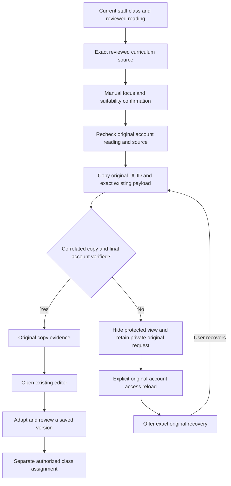

# Manual reading-practice planner

Version 2.11 draft, 6 October 2026. This is the source contract for `/reading-practice`, not a validated intervention, source-rights certification or business acceptance. Read [BRD](BRD.md) → [FSD](FSD.md) → [HLD](HLD.md) → [LLD](LLD.md). Trace: BR-03–BR-08, BR-10–BR-12; FR-02, FR-03, FR-13–FR-18, FR-20–FR-22, FR-26; NFR-01–NFR-03, NFR-05–NFR-09. SC-45–SC-46 add TC-314–TC-329. All designed cases remain `not-run-for-this-specification` and all approvals remain false.

## Business and interface boundary

Staff can inspect a permitted reading observation, select a manual practice focus and an exact reviewed curriculum source, then create a provisional teaching draft. The shared shell exposes one native “Reading practice planner” link to administrator/teacher only; family roles do not inherit it and guardian assigned-learning navigation is not expanded. The protected layout and existing APIs independently enforce staff/current source/class authority; menu visibility grants no access. The educator adapts and reviews a saved version in the existing resource editor before any authorized class assignment. The page does not generate or personalize the copied body, classify a learner, make an individual/group assignment, screen or diagnose, or authenticate an external result.

The staff layout redirects anonymous visitors to sign-in and presents an unavailable message to nonstaff or actors without a school. Client reads and server APIs independently repeat authority checks. Guardian assigned-learning policy, current class/student scope, private answer keys and approval rules remain unchanged. No new endpoint, database table, provider, AI call or message channel is added; inventories remain 41 tables/338 fields and 60 route files/96 handlers.

| Existing interface | Planner use | Authority and result boundary |
|---|---|---|
| `GET /api/session` | Verify the current staff actor before and after context reads and copy | Actor ID/role/school must match; actual server SQL also pins verified session/identity authority |
| `GET /api/classes` | Current permitted class choices | School/class scope comes from the session; previous choices are not an authority grant |
| `GET /api/reading-review?classId=...` | Original/effective manual observations and correction revisions | Exact class/school, provenance and computed values are correlated before display; historical evidence does not prove current enrolment |
| `GET /api/curriculum` and `/api/curriculum/{id}/versions` | Available references and reviewed version choices | Current staff source access; only versions with paired valid reviewer/time are copy choices |
| `GET /api/curriculum/{id}/snapshot?versionId=...` | Exact approved source preview | Source/reference/version/content/approval correlation; declared rights and language are shown, not independently verified |
| `POST /api/curriculum/{id}/draft` | Original source-bound copy or exact original recovery | Only `{versionId,type,clientResourceId}`; existing guarded resource/version/binding operation, 201 for initial or exact committed replay |
| Existing `/resources/{id}` editor | Subsequent adaptation, saved-version review, printing and class assignment | Planner receipt grants no approval or assignment; current editor/server scope controls these separate actions |

## Current evidence and manual suitability

Reload hides previous readings, source content, focus, selected observation and receipt while it verifies session → current class/reference lists → selected class readings → selected source versions/exact snapshot → session. Class and reference lists are read concurrently, but this sequence is not a cross-endpoint database transaction. Mounted generation/abort guards and captured-context identity reject obsolete controls or delayed replies. Denied, malformed, wrong-class/source or changed-account data never becomes a successful empty state or partial private view.

The observation selector labels learner ID, effective date, language and passage reference. Its detail shows correct/attempted counts, duration, descriptive rate/accuracy, original recorder/manual provenance and latest correction revision. The client correlates originals, correction revision and effective values; it does not supply educational norms, grades, passage comparability or current individual eligibility.

The private focus textarea is a decision aid in page memory, with a native 1,000-character limit. If a freshly verified reading list no longer contains an unsent selected observation, both its selection and private unsent focus are cleared. Later restored scope does not automatically reselect that observation or restore its cleared unsent focus; the educator selects and reviews a new plan. Source text is copied as supplied; the planner does not redact or certify an educator-authored source. The source preview shows exact source version, context/objectives/body, declared reuse permission, attribution and reviewer. Different reading/source language tags warn without establishing equivalence or automatically forbidding a separately reviewed copy. Actual licensing and pedagogical suitability require an educator decision.

Staff choose activity, worksheet, lesson or quiz and explicitly confirm the observation, focus, exact source, language and permission. Changing focus, format, observation, class/source/version, or reloading clears review. Missing observation, empty focus, absent approved source or unreviewed choices cannot create a draft. An unreviewed source explains why copying is unavailable; no reading observations explains current availability and links to existing reviewed entry.

## Initial copy and saved evidence

Creation captures the original actor, selected class/check/source/version, complete reading and source snapshots, trimmed private focus, selected format, fresh resource UUID and exact JSON bytes. A synchronous lock prevents duplicate captured actions. Before sending, it rechecks current original staff, current original reading and exact approved source, then current staff again. A changed reading blocks the initial POST and requires new planning review. Server copy authority remains independent of these page checks.

Only the existing copy fields leave the page. Focus, learner identity, reading values, passage reference and correction evidence are never injected into persisted content, teacher notes, answer key or copy payload. The service copies source context/objectives/body, with blank private notes/key, into a separate initially unapproved resource version 1 and durable exact-source binding. Creation sends no assignment and does not approve the resource.

The page correlates resource UUID/author/school, original version 1/type/content/private-field exclusions and source-binding identifiers before accepting a 201 response; it verifies the final account too. The original copied-draft receipt links to the existing editor and is presented separately from current source selection or later resource changes. After a correlated 201 and final original-account verification, the confirmed receipt is saved in page memory before current-context reload. That reload hides its display until current access is verified. A failed reload does not make the confirmed copy pending again; a later authorized reload can restore the original receipt without resending the copy.

This is existing resource/version/binding evidence, not a new immutable registry-style SQL receipt. Exact copy replay returns original version 1 even after later content revisions. Version 1 approval metadata may subsequently reflect an explicit resource review. The planner's receipt confirms the original copy and attribution; it never states current approval, current latest resource content, an assignment or learner progress.

## Original-request recovery

A sent uncertain outcome, invalid receipt, failed final account check or rejected recovery hides all protected views while retaining the original UUID, exact bytes, actor, source, reading and focus privately in mounted-page memory. It blocks new copies and does not retry automatically. Hard reload/navigation discards that memory; it does not delete saved server evidence.

Reload with the original current staff actor and restored original class/reading/source access is required before the pending summary or focus can reappear. Another actor cannot inspect or recover the original request. If the original observation becomes unavailable, the current selection/focus and original source summary stay hidden, recovery is unavailable and a separate copy remains blocked. The original pending UUID/bytes/evidence/focus remain privately retained; a fresh original-account reload after original observation access is restored can expose that exact captured plan for explicit recovery without rebasing it. Explicit **Recover original draft** rechecks current original authority and the exact original approved source, then sends the original bytes and UUID. A later reading correction can remain visible while recovery confirms the original copy; it never rebases the original focus/source/type or turns that earlier copy into a new intervention or assignment.

For an initial attempt, an unsent preflight failure or known 400/409 rejection clears the candidate request and requires fresh separate review. For an already uncertain original recovery, 400/409 retains pending state and blocks duplicate creation; operator/staff inspection of Teaching resources remains a separate next step. Recovery must not silently unlock a new UUID merely because a retry was rejected.

## Test and acceptance boundary

[Reading-practice contracts](../../tests/integration/reading-practice-ui-contract.mjs) use unchanged transpiled callbacks with substituted hooks/elements and actual synthetic sessions/routes/production Drizzle D1 over isolated SQLite. Related cases cover scope, correlation, manual review reset, persisted field exclusions, current initial preflight, original bytes/replay, changed-account/privacy, later corrections/resource revisions, rejected recovery, delayed replies and unmount. These checks do not establish mounted React, assistive focus/keyboard behavior, hosted recovery or educational effectiveness.

TC-321 and TC-329 require intentional mounted accessibility and named educator/operator review. [Wireframes](WIREFRAMES.md) describe the current page structure separately from the unchanged 12-screen fictional prototype. Real identity/ORF configuration, pilot rights/languages, educator suitability, representative capacity and operational/retention decisions remain open. Root-maintained dated execution evidence records actual source/runs/deployment independently; no suite count or source publication promotes case status or approval.
